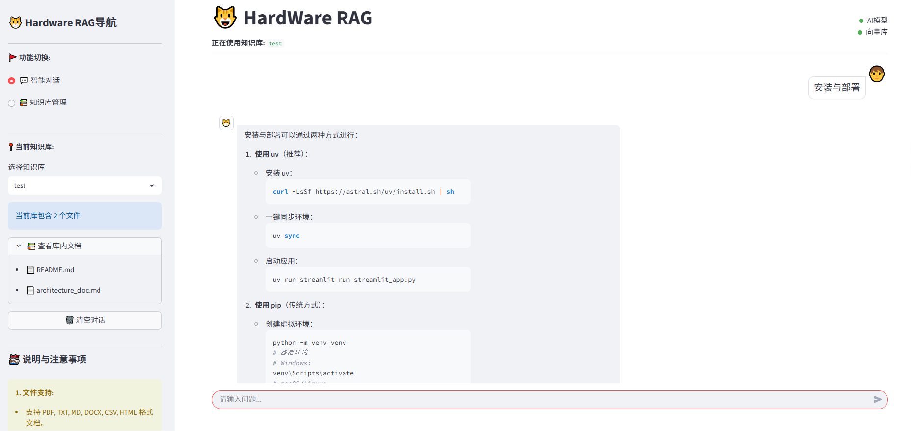
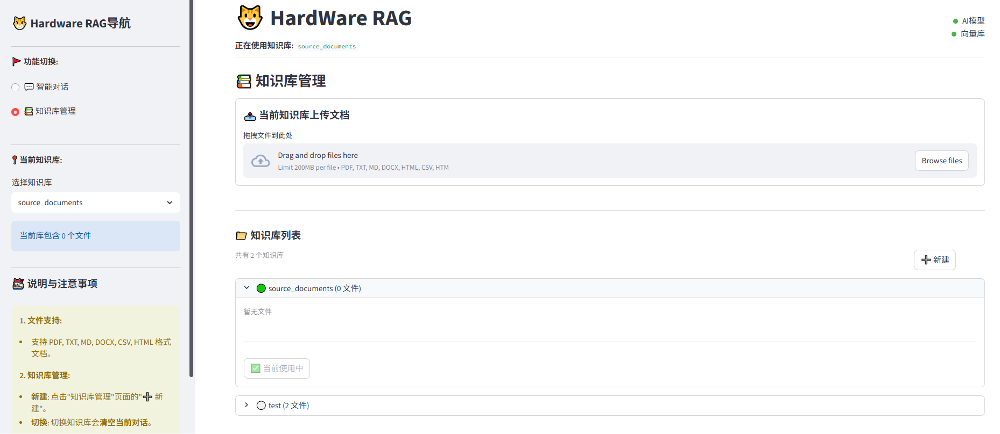

# Hardware DataBase

Hardware DataBase 是一个面向硬件设计资料、项目文档、结构化表格和电路设计（EDF 网表/原理图）的智能数据基座。

## 核心特性

- **Agentic 查询流程**：基于 `deepagents`（`create_deep_agent`）的自主工具调用循环，由模型按问题动态选择多源检索工具、决定检索跳数与顺序，最终给出 grounded answer；不再有写死的「拆解→规划→补检」固定流程。
- **多源 pipeline**：普通文档进入 RAGFlow 检索链路；Excel 进入结构化表格索引；EDF 网表进入电路结构化索引；外部对话记录单独索引；均由 agent 统一调度。
- **RAGFlow 后端固定化**：文档上传、解析任务、检索、删除和知识库治理都通过 RAGFlow 后端适配层完成。
- **权限与治理**：支持部门、用户、知识库权限、审计日志、查询 trace 和文件处理状态。
- **统一模型配置**：答案生成、工具决策和后台模型任务统一走 `src.core.model_factory` profile，并由 chat runtime 负责调用归一化与观测，支持 Ollama 或 OpenAI-compatible API。提示词 `SYSTEM_PROMPT` / `NO_CONTEXT_PROMPT` 可在系统配置中覆盖。
- **结果 Artifact 导出**：已完成的对话/知识库检索结果先固化为不可变 ResultSnapshot，再由独立 export worker 生成 Markdown、Excel、Word、PDF 或 PowerPoint Artifact；聊天消息和全局任务中心提供带权限校验的后台任务状态、重试和下载入口。导出任务不依赖浏览器 SSE，切换会话、页面或刷新页面不会丢失。

## 界面示例





## 项目结构

```text
Hardware-DataBase/
├── assets/                     # 应用示例图片
├── wiki/                       # 系统技术 Wiki（已纳入 git，入口 wiki/README.md）
├── docs/                       # 本地设计/评估笔记（未纳入 git 版本管理）
│   ├── production_readiness_report.md  # 生产化审计报告
│   └── optimization_roadmap.md         # 优化路线
├── evaluation/                 # RAGAS 评估数据集与说明
│   ├── datasets/hardware_qa_v1.jsonl
│   └── README.md
├── src/
│   ├── settings.py             # 全局配置与 .env 加载（单一事实来源）
│   ├── agents/                 # deepagents 查询编排（runner + tools/）
│   ├── circuit/                # 电路网表/原理图解析与结构化检索
│   ├── core/                   # AppPipeline、鉴权、model_factory、会话、source group 路由
│   ├── evaluation/             # RAGAS 评估子系统（CLI、service、metrics、gates）
│   ├── ingestion/              # source group 分类、KB 路径、解析任务、容器检查
│   ├── pipelines/              # 多源 pipeline（document_rag/、spreadsheet/、registry、runtime）
│   ├── services/               # 文档治理、路由、归档、KB scope、资产清理
│   ├── test_data/              # 测试数据结构化域（ingest-only）
├── frontend/                     # React + TypeScript 前端（对接 src/api 的 FastAPI 服务）
│   └── ...
├── storage/                    # (自动生成) 归档、索引、日志与鉴权库
├── deploy/                     # 自管基础设施：observability/、redis/、postgres/
├── scripts/                    # hdb.sh 进程管理 + redis.sh/postgres.sh + production_hardening/
├── tests/                      # 单元与集成测试（unittest.TestCase）
├── src/api/                    # FastAPI 后端（唯一后端入口，见 src/api/routes/）
├── pyproject.toml
├── requirements.txt
└── README.md
```

## 环境要求

- **Python**：>= 3.12
- **RAGFlow**：需准备一个可访问的 RAGFlow 实例作为文档检索后端，并获取其 API Key。
- **Redis（可选）**：`bash scripts/redis.sh up` 起项目自管实例（`127.0.0.1:6380`）。
  启用后取消操作走快路径、跨进程 SSE 实时推送；不启用则自动退化轮询，不影响正确性。
- **PostgreSQL（可选）**：`bash scripts/postgres.sh up && bash scripts/postgres.sh write-env`
  把会话/记忆/检查点/配额五组后端切到项目自管 pgvector 实例（`127.0.0.1:55433`）。
  首次切换先按 `deploy/postgres/README.md` 跑预演；不切换则仍用本地 SQLite。
- **Ollama**：当 `AGENT_LLM_PROVIDER=ollama`（默认）时需要本地 [Ollama](https://ollama.com/) 服务并拉取对应模型；若改用 OpenAI-compatible API 则无需 Ollama。

## 安装

### 方式一：使用 uv（推荐）

[uv](https://github.com/astral-sh/uv) 是一个极速的 Python 包管理器。

安装 uv（如尚未安装）：

```bash
# macOS / Linux
curl -LsSf https://astral.sh/uv/install.sh | sh
# Windows (PowerShell)
powershell -c "irm https://astral.sh/uv/install.ps1 | iex"
```

同步环境并启动后端 API（`uv run` 会自动加载虚拟环境，无需手动 activate）：

```bash
uv sync --all-groups
uv run hardware-database-server   # FastAPI 后端，默认 127.0.0.1:8001（HDB_API_HOST/PORT 可改）
```

另开终端启动前端（Node.js >= 18）：

```bash
cd frontend
npm ci
npm run dev                       # Vite dev server，默认 0.0.0.0:5176，经 proxy 转发 /api 到后端
```

启用可执行 Skill 时，还需按 `deploy/sandbox-runner/README.md` 一次性准备受核验的基础镜像和服务令牌，
然后在启动 API **之前**单独启动独立 Runner：

```bash
uv run python deploy/sandbox-runner/runner.py  # 默认 127.0.0.1:8780；需要 Docker daemon
```

若开启本机沙箱 MCP Gateway（`SANDBOX_GATEWAY_ENABLED=true`），参照
`deploy/mcp-gateway/README.md` 配置独立令牌，并另开终端运行
`uv run python deploy/mcp-gateway/gateway.py`（默认 `127.0.0.1:8781`）。

单机直接运行 `hardware-database-server` 时，API 默认自动拉起对话/解析 Worker 和导出 Worker；
沙箱任务的调度/对账循环也在 API 进程内自动启动，**无需另起沙箱 Worker**。记忆 Worker 默认不自动启动，
如需记忆提炼，可另行运行 `uv run hardware-database-memory-worker`。若采用
`bash scripts/hdb.sh start` 管理 API、前端和所有 Worker，它会关闭 API 的 Worker 自动拉起并
各自启动一次；不要和上述手动启动方式同时使用。Runner（以及按需使用的 MCP Gateway）
始终是单独的服务，不在 `hdb.sh` 中启动。

生产部署用 `npm run build` 产出 `frontend/dist/` 静态文件。

### 方式二：使用 pip

```bash
python -m venv venv
# Windows
venv\Scripts\activate
# macOS / Linux
source venv/bin/activate

pip install -r requirements.txt
uvicorn src.api.app:create_app --factory --host 127.0.0.1 --port 8000
```

## 配置说明

支持两种配置方式：**管理页面配置**（推荐）和 **`.env` 文件配置**。

> 注意：仓库根目录的 `.env` 已提交且包含**真实 API Key**，并残留若干旧架构变量（`RAG_BACKEND`、`PROVIDER`、`CUSTOM_LLM_MODEL`、`BM25_TOP_K`、`RERANKER_TYPE`、`CHUNK_SIZE` 等，`src/settings.py` 已忽略）。请以 `.env.example` 为模板，以下方变量为准。

### 方式一：管理页面配置（推荐）

启动前后端后，用系统管理员登录前端，进入 **「系统配置」** 页面，可直接修改模型、RAGFlow、检索等配置并立即生效，配置会持久化保存到 `.env` 文件。

### 方式二：`.env` 文件配置

在项目根目录创建 `.env`，按需填写（以下为 `src/settings.py` 实际读取的变量及默认值）：

```env
# ==================== RAGFlow 后端 ====================
RAGFLOW_BASE_URL=http://localhost:9380
RAGFLOW_API_KEY=
RAGFLOW_GOVERNANCE_DATASET_NAME=department_governance
RAGFLOW_DESIGN_DATASET_NAME=project_design_assets
RAGFLOW_TIMEOUT_SECONDS=120
RAGFLOW_SIMILARITY_THRESHOLD=0.25
RAGFLOW_VECTOR_WEIGHT=0.4

# ==================== Agent LLM ====================
# provider: ollama | custom
AGENT_LLM_PROVIDER=ollama
AGENT_OLLAMA_BASE_URL=http://localhost:11434
AGENT_OLLAMA_MODEL=qwen2.5:32b
AGENT_TEMPERATURE=0.2
AGENT_TIMEOUT_SECONDS=120

# HTTP 429 重试（仅 custom 提供商生效；重试耗尽后抛出原始错误）
AGENT_RATE_LIMIT_MAX_RETRIES=4
AGENT_RATE_LIMIT_INITIAL_DELAY_SECONDS=1
AGENT_RATE_LIMIT_MAX_DELAY_SECONDS=16

# 或使用 OpenAI-compatible API（provider=custom 时生效）
AGENT_CUSTOM_API_KEY=
AGENT_CUSTOM_BASE_URL=https://api.openai.com/v1
AGENT_CUSTOM_MODEL=
AGENT_CUSTOM_MAX_TOKENS=4096

# ==================== 检索与 Agent 行为 ====================
FINAL_TOP_K=5
AGENT_MAX_RETRIEVAL_ROUNDS=3

# ==================== 鉴权（通常无需修改）====================
AUTH_DB_PATH=storage/auth.db
AUTH_DEFAULT_ADMIN_USERNAME=admin
AUTH_DEFAULT_ADMIN_PASSWORD=
AUTH_SESSION_TTL_HOURS=24

# ==================== 存储路径（通常无需修改）====================
PIPELINE_ARCHIVE_ROOT=storage/pipeline_archives
RAGFLOW_FILE_ROOT=storage/pipeline_archives

# ==================== 提示词（可选）====================
SYSTEM_PROMPT=
NO_CONTEXT_PROMPT=
```

### LangMem 长期记忆

长期记忆由 `hardware-database-memory-worker` 独立低优先级消费。Conversation 的原始消息仍保留在会话库；记忆 Catalog、来源、consent、revision 和 Outbox 位于 `AUTH_DB_PATH`，LangGraph `SqliteStore` 只保存可重建的 Candidate/Verified 投影。

```bash
uv run hardware-database-memory-worker
```

默认 User Memory 为 opt-out，只有用户在 API/前端明确开启并针对具体消息创建 consent event 后才会提炼。选定知识库的 Agent 查询会在模型创建前自动预取当前用户可见的 User/Project Memory，并以有界的 `<untrusted_memory>` 上下文注入；`memory_search` 仍保留为按需补查工具。若部署为单机并希望 API 自动拉起该 Worker，可设置 `HDB_API_SPAWN_MEMORY_WORKER=true`；多实例部署应只运行一个独立 Worker，Phase 1 保持 `MEMORY_SINGLE_WRITER=true`。未配置 embedding 时 Candidate 检索会安全跳过，正式知识库证据和 Datasheet 始终优先于记忆线索。完整配置见 `.env.example`，治理接口见 `GET /api/v1/memories` 及其 action endpoints。

## 查询流程

```text
前端 (React)
  -> FastAPI (/api/v1)  SSE 持久化 turn 事件
  -> AppPipeline
  -> MultiSourceAgentRunner
  -> deepagents agent loop (create_deep_agent)
       - 动态工具调用: 文档检索 / 表格检索 / 电路检索 / 外部对话检索
       - Catalog-first LangMem memory search（仅作为不可信历史线索）
       - 每步 tool_started / tool_result 事件驱动前端实时轨迹
  -> 统一模型封装 (src.core.model_factory)
```

已完成助手消息的“导出结果”菜单支持 Markdown、Excel、Word、PDF、PowerPoint；同一回答可以分别提交多个格式，格式失败不会影响其他任务。用户在对话中明确说“导出/输出/生成为 Excel、PDF”等格式时，服务端会在 turn 完成事务内登记对应后台任务，浏览器只负责订阅和展示；普通提到某种文件格式的检索问题不会误触发。导出 API 为 `POST /api/v1/exports`，任务状态、预览和下载分别通过 `/api/v1/exports/{export_job_id}`、`/api/v1/artifacts/{artifact_id}/preview` 和 `/api/v1/artifacts/{artifact_id}/download` 获取。单机 API 默认拉起独立 export worker；多实例部署可设置 `HDB_API_SPAWN_EXPORT_WORKER=false`，单独运行：

```bash
uv run hardware-database-export-worker
```

Word/PDF 使用后端受控渲染器，PowerPoint 支持 light/dark/blue 主题和从真实数值表生成的柱状图；文件生成不执行用户脚本、不访问用户本地路径或外部网络。`RESULT_EXPORT_ENABLED` 和 `RESULT_EXPORT_{MD,XLSX,DOCX,PDF,PPTX}_ENABLED` 控制灰度发布，前端菜单从 `/api/v1/exports/formats` 获取可用格式，后端仍会强制校验。`RESULT_EXPORT_RETENTION_DAYS` 控制产物保留期，`RESULT_EXPORT_MAX_RUNNING_JOBS` 控制并发运行配额，过期文件由 export worker 清理二进制但保留 Artifact 历史元数据、任务历史和下载审计。Artifact 历史可通过 `GET /api/v1/artifacts` 查询；旧模板文档还可通过 `/api/v1/artifacts/document/{artifact_id}/preview|download` 使用统一访问协议，底层记录保持兼容。

## 常见问题

**Q: 运行 `uv sync` 时提示 lock file is not up to date？**
A: 通常发生在手动修改了 `pyproject.toml` 之后。运行 `uv lock` 更新锁定文件，再执行 `uv sync`。

**Q: 启动时提示 `ModuleNotFoundError`？**
A: 使用 uv 时必须用 `uv run` 启动命令，或先 `source .venv/bin/activate` 再运行；使用 pip 时请确认已激活虚拟环境并安装依赖。

**Q: 上传文件后在问答中搜不到内容？**
A: 当前检索后端为 RAGFlow，请按顺序排查：1) RAGFlow 服务是否可达、`RAGFLOW_API_KEY` 是否正确；2) `RAGFLOW_GOVERNANCE_DATASET_NAME` / `RAGFLOW_DESIGN_DATASET_NAME` 对应的 dataset 是否存在；3) 在「日志中心」或知识库文件页确认 RAGFlow 解析任务是否完成。

**Q: Agent 响应很慢或超时？**
A: 可适当调大 `AGENT_TIMEOUT_SECONDS`；`AGENT_MAX_RETRIEVAL_ROUNDS` 现在直接决定 agent 循环的 `recursion_limit` 预算——调大检索会更充分但更慢，调小则更快但可能检索不足；确认 LLM 模型（Ollama 或 custom API）的响应速度。

**Q: 首次启动后无法使用问答？**
A: 请先以系统管理员进入「系统配置」检查并补全 RAGFlow 与 Agent 模型配置，保存后生效。

## RAGAS 回答质量评估

项目提供独立的 RAGAS 评估子系统，可在线调用真实问答管线，也可对保存的回答快照离线重评。内置数据集 `evaluation/datasets/hardware_qa_v1.jsonl` 包含 25 条电路、文档、联合检索、多跳、缺失证据、冲突、权限和直答用例。

安装评估依赖并校验数据集：

```powershell
uv sync --group eval
uv run hardware-database-eval validate --dataset evaluation/datasets/hardware_qa_v1.jsonl
```

运行端到端评估或重评已有快照：

```powershell
uv run hardware-database-eval run --dataset evaluation/datasets/hardware_qa_v1.jsonl --output storage/evaluations
uv run hardware-database-eval score --dataset evaluation/datasets/hardware_qa_v1.jsonl --snapshot storage/evaluations/<run_id>/snapshot.jsonl --output storage/evaluations
```

默认只生成 JSON、CSV 和 HTML 报告。需要在 CI 中启用阈值门禁时添加 `--fail-on-threshold`。可用 `--tag`、`--sample-id`、`--metric` 和 `--threshold faithfulness=0.8` 过滤或覆盖评分设置。

裁判 LLM 默认复用 `AGENT_*`。Embedding 必须通过 `EVAL_EMBEDDING_BASE_URL`、`EVAL_EMBEDDING_API_KEY` 和 `EVAL_EMBEDDING_MODEL` 显式配置；完整示例见 `.env.example`。前端「RAGAS 评估」页面仅系统管理员可见。页面创建评估时会先选择已登记知识库并执行预检，服务端按稳定 `kb_id` 绑定知识库，员工没有 RAGAS 入口。

管理员可在该页面查看运行阶段、当前样本、完成/总数、成功/失败数和已耗时间。“暂停”和“取消”均为协作式操作：它们会等待正在执行的模型请求结束，并在下一个安全检查点生效；“取消”不会删除 `snapshot.jsonl`；“继续”会跳过其中已成功的样本。已完成、失败和已取消的历史运行可以删除，运行目录外的共享快照不受影响。历史对比默认严格校验知识库、样本集和模型配置，也可以明确选择带警告的“仅查看对比”。在线运行先采集回答和检索证据，进入采集质检状态后再由管理员点击“开始评分”；评分依赖和裁判模型预检只在真正进入评分阶段时执行。

- 评估数据集格式与扩展方式：`evaluation/README.md`
- 运行产物：`storage/evaluations/<run_id>/`
- `snapshot.jsonl` 保存回答和检索上下文，可更换裁判模型重复评分。
- `retrieved_contexts` 保存原始检索结果；正式评分时 `results.jsonl` 中 `metadata.ragas_scoring.scored_contexts` 保存按原始顺序完整送入 RAGAS 的上下文。评分任务进度只表示工作项完成情况，不能替代有效评分数和评分失败数。
- 每个运行目录都会保存 `run_state.json`。在线运行在至少持久化一条采集结果后，才会在该目录生成 `snapshot.jsonl`；离线运行则引用所提供的快照路径，该路径可能位于运行目录之外。只有完成评分的运行才会生成 `summary.json`、`results.jsonl`、`summary.csv` 和 `report.html`。
- `summary.json` 是自动化消费的权威汇总，`summary.csv` 用于表格分析，`report.html` 用于人工查看。
- 单题或单指标失败不会终止整批；`not_applicable` 不计入指标均值。

## 说明

- “知识库”现在是业务隔离与权限治理单元，不代表本地向量库。
- 检索后端固定为 RAGFlow，项目内不再维护本地向量索引。
- Excel 等结构化数据不走本地 RAG，而是由 spreadsheet pipeline 建立结构化索引后交给 agent 调度。

## License

MIT License
