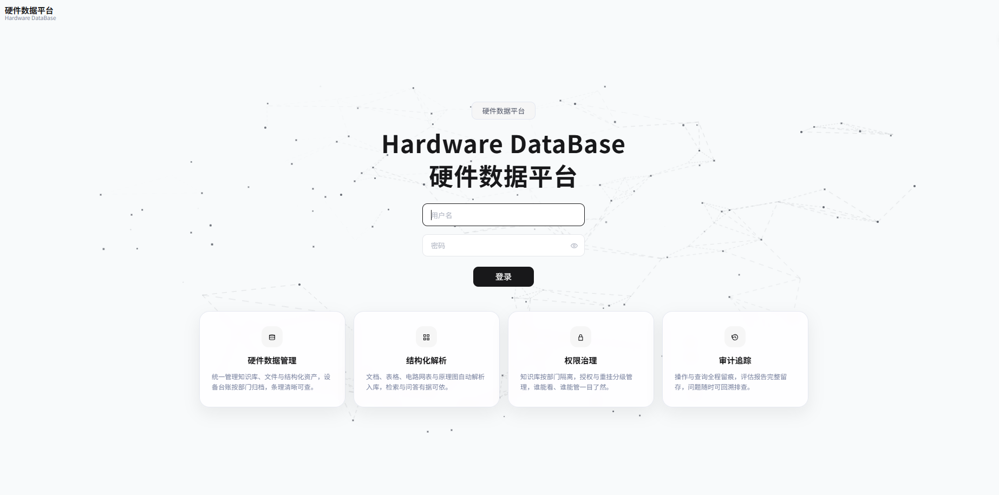
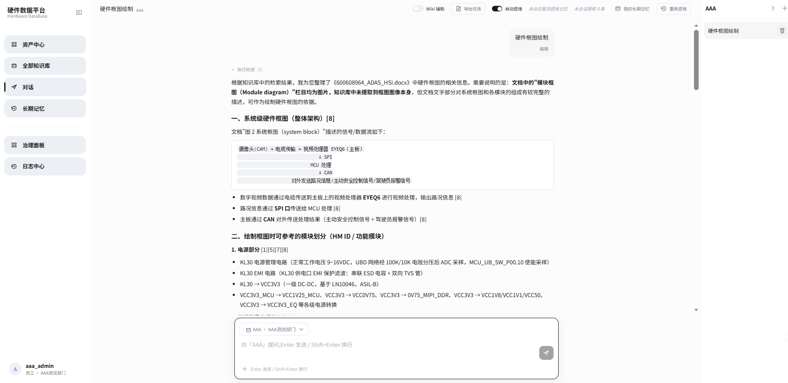

<div align="center">

# Hardware DataBase

**面向硬件设计资料的多源智能问答与文档生成基座**

把散落在技术文档、结构化表格、电路设计（EDF 网表 / 原理图）与历史对话中的硬件知识，
收敛为一个**可检索、可追溯、可治理、可导出**的统一数据基座。


</div>

## ✨ 核心特性

| | 能力 | 说明 |
|---|---|---|
| 🧠 | **Agentic 查询** | 基于 `deepagents` 的自主工具调用循环：模型按问题动态选择多源检索工具、决定检索跳数与顺序，最终给出 grounded answer，不再有写死的「拆解 → 规划 → 补检」固定流程 |
| 🗂 | **多源 Pipeline** | 普通文档进 RAGFlow 检索链路；Excel 进结构化表格索引；EDF 网表进电路结构化索引；外部对话记录单独索引——全部由 agent 统一调度 |
| 🔌 | **RAGFlow 固定后端** | 文档上传、解析任务、检索、删除、知识库治理统一走 RAGFlow 适配层，项目内不维护本地向量索引 |
| 🛡 | **权限与治理** | 部门、用户、知识库权限、审计日志、查询 trace、文件处理状态 |
| 🧩 | **外部扩展** | 受治理的远程 MCP 工具、文本 Skill 与审核后沙箱 Skill；默认关闭并按部门和订阅授权，见[操作指南](docs/mcp-plugins.md)与[技术 Wiki](wiki/22-external-extensions.md) |
| ⚙️ | **统一模型配置** | 答案生成、工具决策与后台模型任务统一走 `src.core.model_factory` profile，由 chat runtime 负责调用归一化与观测；支持 Ollama 与任意 OpenAI-compatible API |
| 📤 | **结果导出** | 对话/检索结果先固化为不可变 ResultSnapshot，再由独立 export worker 生成 Markdown / Excel / Word / PDF / PowerPoint；后台任务带权限校验，切页面、刷新、断线都不丢 |
| 🧠 | **长期记忆** | LangMem 驱动的 User / Project Memory：默认 opt-out、显式 consent、有界注入为不可信线索，正式证据始终优先 |
| 🚦 | **资源治理** | LLM 并发闸门 + 排队 + OCR / 工具 / 重任务配额；`deployment` 作用域下多进程、多副本共享 |
| 📊 | **RAGAS 评估** | 在线跑真实问答管线，或对保存的回答快照离线重评；支持阈值门禁与历史对比 |

## 🖼 界面预览

| 知识库问答 | 知识资产治理 |
|---|---|
|  |  |

## 🚀 快速开始

### 环境要求

| 组件 | 要求 | 必需 |
|---|---|---|
| Python | >= 3.12 | ✅ |
| RAGFlow | 可访问的实例 + API Key（文档检索后端） | ✅ |
| LLM | Ollama（默认）或任意 OpenAI-compatible API | ✅ |
| PostgreSQL | pgvector 实例（生产账本库）；Docker 编排内自带 | ✅（生产） |
| Redis | 实时平面（取消快路径 + 跨进程 SSE）；Docker 编排内自带 | ✅ |
| Docker | 20+ / compose v2（方式一） | 方式一 |
| Node.js | >= 18（前端开发与构建） | 前端 |

> PostgreSQL 与 Redis 均为**必需组件**，不做降级：Redis 默认 `REDIS_REQUIRED=true`，启动时校验连通性，不可用即拒绝启动。

### 方式一：Docker（推荐，一条命令起全套）

```bash
# 在仓库根目录执行
bash deploy/docker/quickstart.sh
```

脚本会：生成 PostgreSQL 密码与管理员口令（打印在终端）→ 构建镜像 → 按
`postgres → migrate → api → web` 顺序启动。访问 `http://<主机IP>:8080`，
用 `admin` + 终端打印的口令登录。

- 只准备文件不启动：`bash deploy/docker/quickstart.sh --no-start`
- 镜像源加速、内网离线分发、指向已有 PostgreSQL、备份恢复：见 [`deploy/docker/README.md`](deploy/docker/README.md)

### 方式二：uv（源码开发，推荐）

```bash
# 安装 uv（已安装可跳过）
curl -LsSf https://astral.sh/uv/install.sh | sh      # macOS / Linux
powershell -c "irm https://astral.sh/uv/install.ps1 | iex"   # Windows

uv sync --all-groups
uv run hardware-database-server      # FastAPI 后端，默认 127.0.0.1:8001（HDB_API_HOST/PORT 可改）
```

前端另开一个终端：

```bash
cd frontend
npm ci
npm run dev                          # Vite dev server，默认 127.0.0.1:5176，/api 反代到后端
```

启用可执行 Skill 时，还需按 `deploy/sandbox-runner/README.md` 一次性准备受核验的基础镜像和服务令牌，
然后在启动 API **之前**单独启动独立 Runner：

```bash
uv run python deploy/sandbox-runner/runner.py  # 默认 127.0.0.1:8780；需要 Docker daemon
```

若开启本机沙箱 MCP Gateway（`SANDBOX_GATEWAY_ENABLED=true`），参照
`deploy/mcp-gateway/README.md` 配置独立令牌，并另开终端运行
`uv run python deploy/mcp-gateway/gateway.py`（默认 `127.0.0.1:8781`）。

单机直接运行 `hardware-database-server` 时，API 默认自动拉起对话/解析 Worker 和导出 Worker；
沙箱任务的调度/对账循环也在 API 进程内自动启动，**无需另起沙箱 Worker**。记忆 Worker 默认不自动启动，
如需记忆提炼，可另行运行 `uv run hardware-database-memory-worker`。若采用
`bash scripts/hdb.sh start` 管理 API、前端和所有 Worker，它会关闭 API 的 Worker 自动拉起并
各自启动一次；不要和上述手动启动方式同时使用。Runner（以及按需使用的 MCP Gateway）
始终是单独的服务，不在 `hdb.sh` 中启动。

生产部署用 `npm run build` 产出 `frontend/dist/` 静态文件。

自管数据库（可选但推荐）：

```bash
bash scripts/redis.sh up                          # Redis，127.0.0.1:6380
bash scripts/postgres.sh up                       # pgvector，127.0.0.1:55433
bash scripts/postgres.sh write-env                # 把会话/记忆/检查点/配额等后端切到 PG
```

首次切换先按 [`deploy/postgres/README.md`](deploy/postgres/README.md) 跑预演；不切换则仍用内嵌 SQLite。

### 方式三：pip

```bash
python -m venv venv
source venv/bin/activate             # Windows: venv\Scripts\activate

pip install -r requirements.txt
uvicorn src.api.app:create_app --factory --host 127.0.0.1 --port 8000
```

### 首次配置

1. 用 `admin` + 安装时打印的口令登录
2. 进入 **「系统配置」** 页面，填 **RAGFlow**（地址 / API Key / 数据集）与 **模型端点**（Ollama 或 OpenAI 兼容），保存即生效
3. 建知识库 → 上传文件 → 提问验证

### 进程一览

| 进程 | 命令 | 作用 |
|---|---|---|
| API | `hardware-database-server` | FastAPI 唯一后端入口（单机默认内含 worker） |
| Worker | `hardware-database-worker` | 解析任务与对话 turn 消费 |
| Export worker | `hardware-database-export-worker` | Markdown / Excel / Word / PDF / PPTX 产物生成 |
| Memory worker | `hardware-database-memory-worker` | LangMem 低优先级记忆提炼 |
| Maintenance | `hardware-database-maintenance` | 运维 CLI |
| Eval | `hardware-database-eval` | RAGAS 评估 CLI |
| E2E | `hardware-database-e2e` | 端到端回归 |

## 📖 文档导航

| 文档 | 内容 |
|---|---|
| [`wiki/README.md`](wiki/README.md) | 系统技术 Wiki：总览、架构、API 与鉴权、对话 turn、Agent 运行时、工具与证据、模型与资源、ingestion |
| [`deploy/docker/README.md`](deploy/docker/README.md) | Docker 部署、镜像源加速、内网离线分发、外部 PostgreSQL、备份恢复 |
| [`docs/mcp-plugins.md`](docs/mcp-plugins.md) | MCP 插件与文本/执行型 Skill 的管理员、员工操作和排障 |
| [`deploy/mcp-sandbox/README.md`](deploy/mcp-sandbox/README.md) | Sandbox Gateway/Runner 部署边界、运行档位与安全门禁 |
| [`wiki/22-external-extensions.md`](wiki/22-external-extensions.md) | MCP、Skill 与 Sandbox 的架构、授权和生命周期 |
| [`deploy/postgres/README.md`](deploy/postgres/README.md) | 自管 pgvector 实例与账本库迁移预演 |
| [`evaluation/README.md`](evaluation/README.md) | RAGAS 数据集格式与扩展方式 |
| [`.env.example`](.env.example) | 全量配置项与默认值 |
| [`CLAUDE.md`](CLAUDE.md) | 开发约定与仓库结构（面向贡献者与 AI 编码助手） |

## 🏗️ 架构

```text
前端 (React + TypeScript)
  └─ FastAPI (/api/v1)            SSE 持久化 turn 事件
       └─ AppPipeline
            └─ MultiSourceAgentRunner
                 └─ deepagents agent loop (create_deep_agent)
                      ├─ 动态工具调用：文档检索 / 表格检索 / 电路检索 / 外部对话检索
                      ├─ Catalog-first 记忆检索（仅作为不可信历史线索）
                      └─ 每步 tool_started / tool_result 事件驱动前端实时轨迹
       └─ 统一模型封装 (src.core.model_factory) → Ollama / OpenAI 兼容
```

**存储平面**

| 平面 | 组件 | 内容 |
|---|---|---|
| 账本 / 控制面 | PostgreSQL（pgvector） | 项目、知识库、会话、记忆投影、检查点、配额、审计 |
| 实时平面 | Redis | 取消快路径、跨进程 SSE 事件流 |
| 文档检索 | RAGFlow | 上传、解析、检索、知识库治理 |
| 归档 | `storage/` | pipeline 归档、索引、日志 |

**目录结构**

```text
Hardware-DataBase/
├── src/
│   ├── settings.py          # 全局配置与 .env 加载（单一事实来源）
│   ├── api/                 # FastAPI 后端（唯一后端入口，路由见 api/routes/）
│   ├── agents/              # deepagents 查询编排（runner + tools/）
│   ├── core/                # AppPipeline、鉴权、model_factory、会话、source group 路由
│   ├── pipelines/           # 多源 pipeline（document_rag / spreadsheet / registry / runtime）
│   ├── circuit/             # 电路网表 / 原理图解析与结构化检索
│   ├── document_authoring/  # 文档生成与模板
│   ├── result_exports/      # 结果导出（Markdown / Excel / Word / PDF / PPTX）
│   ├── memory/              # LangMem 长期记忆
│   ├── evaluation/          # RAGAS 评估子系统（CLI / service / metrics / gates）
│   ├── ingestion/           # source group 分类、KB 路径、解析任务
│   ├── services/            # 文档治理、路由、归档、KB scope、资产清理
│   ├── storage/             # 存储适配层（控制面 / 各业务域后端）
│   └── workers/             # 后台 worker
├── frontend/                # React + TypeScript 前端
├── deploy/                  # 自管基础设施：docker/、postgres/、redis/、observability/
├── evaluation/              # RAGAS 评估数据集与说明
├── wiki/                    # 系统技术 Wiki（已纳入 git）
├── scripts/                 # hdb.sh 进程管理 + redis.sh / postgres.sh + production_hardening/
├── tests/                   # 单元与集成测试（pytest，unittest.TestCase 风格）
├── storage/                 # (自动生成) 归档、索引、日志与鉴权库
└── pyproject.toml
```

## ⚙️ 配置

支持两种方式：**管理页面配置**（推荐，保存即热生效）与 **`.env` 文件配置**。

> ⚠️ `.env` 已被 `.gitignore` 忽略，**不要**提交进仓库。请以 [`.env.example`](.env.example) 为模板创建本地 `.env`。
> Docker 部署时，`deploy/docker/config/.env`（容器内 `/app/config/.env`）是权威配置源，改完执行 `docker compose up -d --force-recreate api`。

常用配置项：

| 变量 | 默认 | 说明 |
|---|---|---|
| `RAGFLOW_BASE_URL` / `RAGFLOW_API_KEY` | — | RAGFlow 后端地址与密钥 |
| `RAGFLOW_GOVERNANCE_DATASET_NAME` / `RAGFLOW_DESIGN_DATASET_NAME` | `department_governance` / `project_design_assets` | 治理库 / 设计资产库数据集 |
| `AGENT_LLM_PROVIDER` | `ollama` | `ollama` \| `custom` |
| `AGENT_OLLAMA_BASE_URL` / `AGENT_OLLAMA_MODEL` | `http://localhost:11434` / `qwen2.5:32b` | Ollama 端点与模型 |
| `AGENT_CUSTOM_BASE_URL` / `AGENT_CUSTOM_MODEL` / `AGENT_CUSTOM_API_KEY` | — | OpenAI-compatible 端点 |
| `AGENT_TIMEOUT_SECONDS` | `120` | 模型调用超时 |
| `FINAL_TOP_K` | `5` | 送入答案的检索条数 |
| `AGENT_MAX_RETRIEVAL_ROUNDS` | `3` | agent 检索轮数（同时决定 `recursion_limit` 预算） |
| `LLM_MAX_CONCURRENCY` | `4` | LLM 总并发闸门（交互 + 批量共用） |
| `LLM_BATCH_MAX_CONCURRENCY` | `1` | 批量任务并发上限（必须小于总闸门） |
| `REDIS_REQUIRED` | `true` | Redis 缺失即拒绝启动 |
| `RESOURCE_GOVERNOR_ENABLED` | `true` | 资源治理与配额 |
| `RESULT_EXPORT_ENABLED` | `true` | 结果导出总开关 |
| `MEMORY_ENABLED` | `true` | 长期记忆 |
| `CHAT_ATTACHMENT_OCR_ENABLED` | `true` | 聊天附件 OCR |

完整列表与注释见 [`.env.example`](.env.example)。

## 📤 结果导出

已完成助手消息的「导出结果」菜单支持 Markdown、Excel、Word、PDF、PowerPoint，同一回答可分别提交多个格式，**单个格式失败不影响其他任务**。

- 对话中明确说「导出 / 输出 / 生成为 Excel、PDF」时，服务端在 turn 完成事务内登记后台任务，浏览器只负责订阅与展示；普通提到文件格式的检索问题不会误触发
- 相关接口：`POST /api/v1/exports`、`GET /api/v1/exports/{export_job_id}`、`GET /api/v1/artifacts/{artifact_id}/preview|download`
- Word / PDF 使用后端受控渲染器；PowerPoint 支持 light / dark / blue 主题与从真实数值表生成的柱状图
- **安全边界**：生成过程不执行用户脚本、不访问用户本地路径或外部网络
- 灰度与配额：`RESULT_EXPORT_ENABLED`、`RESULT_EXPORT_{MD,XLSX,DOCX,PDF,PPTX}_ENABLED`、`RESULT_EXPORT_MAX_RUNNING_JOBS`
- 保留期由 `RESULT_EXPORT_RETENTION_DAYS` 控制：过期文件由 export worker 清理二进制，但保留 Artifact 历史元数据、任务历史与下载审计

多实例部署可设置 `HDB_API_SPAWN_EXPORT_WORKER=false` 并单独运行：

```bash
uv run hardware-database-export-worker
```

## 🧠 长期记忆

长期记忆由 `hardware-database-memory-worker` 独立低优先级消费。Conversation 原始消息仍保留在会话库；记忆 Catalog、来源、consent、revision 与 Outbox 位于账本库，LangGraph `SqliteStore` 只保存可重建的 Candidate / Verified 投影。

```bash
uv run hardware-database-memory-worker
```

- 默认 User Memory 为 **opt-out**：只有用户在 API/前端明确开启、并针对具体消息创建 consent event 后才会提炼
- 选定知识库的 Agent 查询会在模型创建前自动预取当前用户可见的 User / Project Memory，并以有界的 `<untrusted_memory>` 上下文注入；`memory_search` 仍保留为按需补查工具
- 单机部署可设 `HDB_API_SPAWN_MEMORY_WORKER=true` 由 API 自动拉起；多实例部署应只运行一个独立 Worker，Phase 1 保持 `MEMORY_SINGLE_WRITER=true`
- 未配置 embedding 时 Candidate 检索会安全跳过；**正式知识库证据与 Datasheet 始终优先于记忆线索**

## 📊 RAGAS 评估

项目提供独立的 RAGAS 评估子系统，可在线调用真实问答管线，也可对保存的回答快照离线重评。内置数据集 `evaluation/datasets/hardware_qa_v1.jsonl` 覆盖电路、文档、联合检索、多跳、缺失证据、冲突、权限与直答用例。

```bash
uv sync --group eval

# 校验数据集
uv run hardware-database-eval validate --dataset evaluation/datasets/hardware_qa_v1.jsonl

# 端到端评估
uv run hardware-database-eval run --dataset evaluation/datasets/hardware_qa_v1.jsonl --output storage/evaluations

# 对已有快照换裁判模型重评
uv run hardware-database-eval score --dataset evaluation/datasets/hardware_qa_v1.jsonl \
  --snapshot storage/evaluations/<run_id>/snapshot.jsonl --output storage/evaluations
```

- 默认生成 JSON、CSV、HTML 报告；CI 中可用 `--fail-on-threshold` 启用阈值门禁
- 支持 `--tag`、`--sample-id`、`--metric`、`--threshold faithfulness=0.8` 过滤或覆盖评分设置
- 裁判 LLM 默认复用 `AGENT_*`；Embedding 必须通过 `EVAL_EMBEDDING_BASE_URL`、`EVAL_EMBEDDING_API_KEY`、`EVAL_EMBEDDING_MODEL` 显式配置
- 前端「RAGAS 评估」页面仅系统管理员可见，创建评估时按稳定 `kb_id` 绑定知识库并执行预检
- 运行产物在 `storage/evaluations/<run_id>/`：`run_state.json` 记录阶段，`snapshot.jsonl` 保存回答与检索上下文，只有完成评分才会生成 `summary.json` / `results.jsonl` / `summary.csv` / `report.html`
- 单题或单指标失败不会终止整批；`not_applicable` 不计入指标均值

## 🧪 测试

```bash
uv run python -m pytest                                # 全量（tests/ 为 unittest.TestCase 风格）
uv run python -m pytest tests/test_kb_scope.py          # 单文件
cd frontend && npm test                                 # 前端 vitest
```

## ❓ 常见问题

**Q：`uv sync` 提示 lock file is not up to date？**
A：通常发生在手动修改 `pyproject.toml` 之后。运行 `uv lock` 更新锁定文件，再执行 `uv sync`。

**Q：启动时提示 `ModuleNotFoundError`？**
A：使用 uv 时必须用 `uv run` 启动命令，或先 `source .venv/bin/activate`；使用 pip 时请确认已激活虚拟环境并安装依赖。

**Q：上传文件后在问答中搜不到内容？**
A：检索后端为 RAGFlow，按顺序排查：1）RAGFlow 是否可达、`RAGFLOW_API_KEY` 是否正确；2）`RAGFLOW_GOVERNANCE_DATASET_NAME` / `RAGFLOW_DESIGN_DATASET_NAME` 对应 dataset 是否存在；3）在「日志中心」或知识库文件页确认 RAGFlow 解析任务是否完成。

**Q：Agent 响应很慢或超时？**
A：可适当调大 `AGENT_TIMEOUT_SECONDS`；`AGENT_MAX_RETRIEVAL_ROUNDS` 直接决定 agent 循环的 `recursion_limit` 预算——调大检索更充分但更慢，调小更快但可能检索不足。同时确认 LLM 端点（Ollama 或 custom API）的响应速度。

**Q：首次启动后无法使用问答？**
A：请先以系统管理员进入「系统配置」，补全 RAGFlow 与 Agent 模型配置，保存后生效。

## 🗺️ Roadmap

- [x] 多源检索（文档 / 表格 / 电路 / 外部对话）统一 Agent 调度
- [x] PostgreSQL 单库收敛 + Redis 实时平面
- [x] 结果导出（Markdown / Excel / Word / PDF / PPTX）与后台任务中心
- [x] RAGAS 评估子系统与阈值门禁
- [ ] 嵌入文档（聊天附件）的结构化解析与路由统一
- [ ] 拒答 / 置信度机制与文档版本时效治理
- [ ] 模型升级放权流程与多副本部署形态完善

## 🤝 贡献

欢迎提交 Issue 与 Pull Request。

1. 先读 [`wiki/README.md`](wiki/README.md)（架构与模块职责）与 [`CLAUDE.md`](CLAUDE.md)（开发约定）
2. 提交前确保 `uv run python -m pytest` 全绿
3. 保持 `tests/test_<topic>.py` 的扁平组织方式与现有代码风格（ruff）

## 📄 License

[MIT](LICENSE) © 2025 Luke Yu

## 🙏 致谢

感谢这些开源项目让本项目成为可能：

[RAGFlow](https://github.com/infiniflow/ragflow) ·
[deepagents](https://github.com/langchain-ai/deepagents) ·
[LangGraph](https://github.com/langchain-ai/langgraph) ·
[LangMem](https://github.com/langchain-ai/langmem) ·
[pgvector](https://github.com/pgvector/pgvector) ·
[Redis](https://redis.io/) ·
[RAGAS](https://github.com/explodinggradients/ragas) ·
[React](https://react.dev/) · [Vite](https://vite.dev/) ·
[Tesseract OCR](https://github.com/tesseract-ocr/tesseract)
