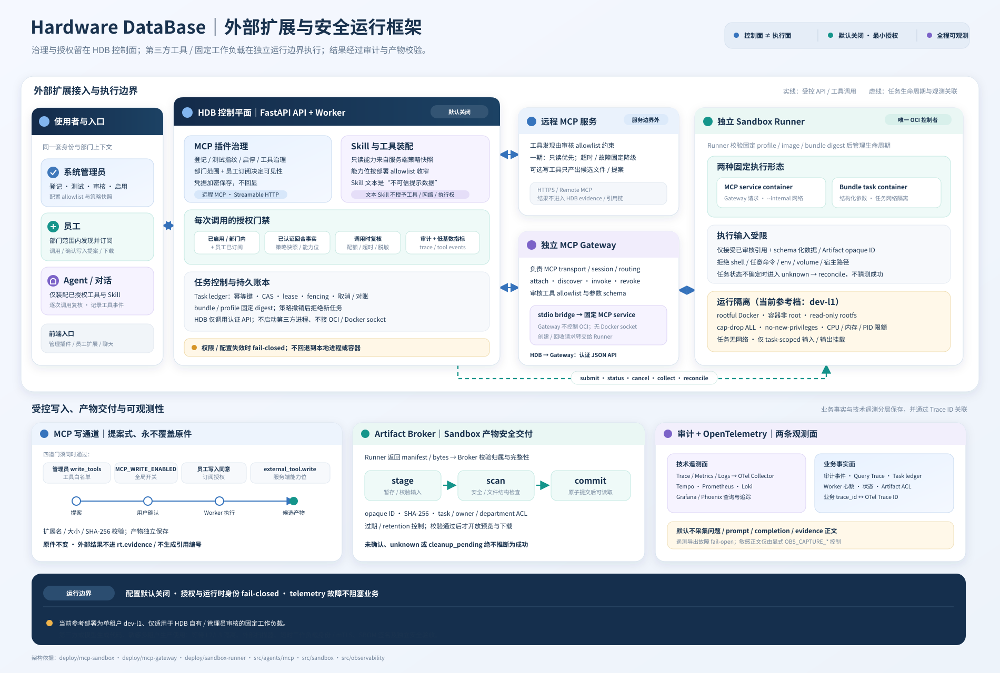

# HDB MCP Gateway / Sandbox Runner boundary

This directory documents the deployment boundary introduced by the HDB
control-plane code. It is **not** a claim that the current development host
has a production-safe sandbox runtime.



Related documentation: [administrator and employee operations](../../docs/mcp-plugins.md),
[extension architecture](../../wiki/22-external-extensions.md),
[Runner deployment](../sandbox-runner/README.md), and
[Gateway deployment](../mcp-gateway/README.md).

## Current P0 status (2026-09-23)

This host has only rootful Docker. A separately deployed dev-l1 Runner and
Gateway are enabled here for HDB-owned fixed workloads. For third-party,
generated or sensitive multi-tenant workloads, keep the following configuration
until an L2/L3 runtime is validated:

```env
SANDBOX_ENABLED=false
SANDBOX_GATEWAY_ENABLED=false
SANDBOX_BACKEND=disabled
SANDBOX_DEFAULT_NETWORK=none
SANDBOX_ALLOW_DYNAMIC_INSTALL=false
```

The HDB control plane includes:

- durable task ledger with idempotency, CAS, leases, fencing tokens and an
  explicit uncertain/reconciliation state machine (`src/sandbox/task_store.py`);
- submit → observe → cancel → collect → reconcile lifecycle adapter that only
  finalizes `succeeded` after Broker hash/ACL/scanner/atomic-commit checks
  (`src/sandbox/service.py`);
- reviewed bundle/profile catalog with bounded input/output JSON-schema subset
  and runtime-policy digest (`src/sandbox/catalog.py`, `src/sandbox/schema.py`);
- Artifact Broker with opaque IDs, archive safety, scan/commit separation,
  expiry and task/owner/department ACLs (`src/sandbox/artifact_broker.py`);
- server-owned capability grants (`sandbox.*`, `external_tool.*`) that can only
  narrow the deployment allowlist (`src/sandbox/authorization.py`);
- Gateway declaration registry with reviewed tool allowlist, schema binding,
  subscriptions and per-invocation authorization
  (`src/agents/mcp/gateway.py`);
- text-only Skill catalog whose content is loaded only as bounded untrusted
  prompt data and never changes tools/capabilities (`src/sandbox/skills.py`);
  a separate reviewed binding may invoke a fixed bundle, but never executes
  code copied from the Skill text.

An independent Runner and Gateway and the dev-l1 profile now have real runtime
tests. Production is still blocked on L2/L3 runtime verification, SBOM/signature,
external scanner, short-lived workload identity or mTLS, and broader chaos,
recovery and tenant-isolation acceptance.

Do not mount `/var/run/docker.sock` into HDB, the Agent Runner, or the MCP
Gateway. HDB only calls the authenticated Runner/Gateway APIs represented by
`src/sandbox/client.py`; it never imports an OCI/Docker SDK and never starts a
third-party process.

## Required deployment decision before enabling

An operator must select and record all of the following outside the ordinary
HDB configuration page:

1. a concrete runtime and version with a fixed, reviewed bundle/profile digest;
2. non-root identity, read-only root filesystem, seccomp/capability policy,
   cgroup/PID/CPU/memory/output limits, and process-group cleanup;
3. default-deny networking (or a separately reviewed egress proxy and domain
   allowlist);
4. mTLS or equivalent short-lived workload identity, audience validation and
   replay protection between HDB, Gateway and Runner;
5. an artifact scanner, atomic commit protocol, cross-department ACL and
   retention/deletion policy;
6. restart, timeout, cancellation, orphan-runtime and unknown-execution
   reconciliation tests.

Until those checks are recorded and exercised against the intended runtime,
`SANDBOX_BACKEND=runner_api` must not be enabled for production or untrusted
workloads. A failed profile check rejects the task; it never falls back to an
unprotected container or a local subprocess.

The code enforces the same gate: enabling `SANDBOX_ENABLED`/`SANDBOX_GATEWAY_ENABLED`
requires `SANDBOX_BACKEND=runner_api`, a Runner URL, a service identity
reference, a recorded runtime attestation with a fixed profile digest and an
artifact scanner reference. An enabled deployment without an injected
authenticated client (for example `SANDBOX_SERVICE_TOKEN_FILE`) reports
`degraded` and the dispatcher/reconciler loops stay stopped.

## Endpoint contract expected from the independent services

HDB only calls these authenticated JSON endpoints (prefix `/v1` by default):

| Method | Path | Purpose |
| --- | --- | --- |
| POST | `/v1/tasks` | submit a reviewed bundle reference |
| GET | `/v1/tasks/{task_id}` | observe state/execution identity |
| POST | `/v1/tasks/{task_id}/cancel` | request cancellation |
| POST | `/v1/tasks/{task_id}/collect` | collect output manifest/bytes |
| POST | `/v1/reconcile[/{task_id}]` | reconcile unknown executions |
| POST | `/v1/generated-bundles/{bundle_ref}/purge` | remove a generated Skill bundle + image (only when no unfinished task references it) |
| GET | `/v1/gateway/health` | gateway health |
| POST | `/v1/gateway/attach` | attach a reviewed deployment/profile |
| POST | `/v1/gateway/{deployment_ref}/invoke` | invoke an allowlisted tool |

Every request carries `X-Request-ID`, `X-Actor-ID`, `X-Department-ID`,
`X-Policy-Snapshot-Hash`, `X-Capability-Snapshot`, `X-Audience` and, when the
task has one, `X-Capability-Snapshot-Hash`; the bearer token comes from the
deployment identity provider, never from `SANDBOX_SERVICE_AUTH_REF` itself.

## Component ownership

| Component | May control OCI/runtime? | Responsibility |
| --- | ---: | --- |
| HDB API/Worker | No | registration, authorization, task ledger, audit |
| HDB Agent Runner | No | assemble already-authorized tools and submit references |
| MCP Gateway | No | MCP transport/session/routing and service governance |
| Sandbox Runner | Yes (only here) | task/session/service lifecycle and cleanup |
| Artifact Broker | No | opaque IDs, scan/commit, ACL and retention |

The Runner receives references and structured schema values, not HDB database
credentials, host paths, shell text or arbitrary environment snapshots.

## 2026-09-22 reference deployment (dev-l1 profile)

A reference Runner and MCP Gateway are now implemented and validated on this
host for the **HDB-owned fixed-digest** first phase only:

- `deploy/sandbox-runner/` — the only OCI control plane (fixed bundles,
  task ledger, cancel/timeout/reconcile, inline artifact manifests);
- `deploy/mcp-gateway/` — MCP routing/governance; asks the Runner for a fixed
  read-only stdio MCP service profile and bridges `tools/call`;
- runtime profile `dev-l1`: rootful Docker with read-only rootfs, cap-drop ALL,
  no-new-privileges, non-root, PID/memory/CPU limits, `--internal` service
  network (no outbound connectivity), task-scoped input/output bind mounts only;
- scanner `scanner://builtin/basic-v1` (bounded structural checks only);
- text-only Skill catalog enabled (`SKILLS_ENABLED=true`): reviewed skills load
  as bounded untrusted prompt data and never change tools/capabilities.

### Skill execution boundary (dev-l1 reference)

Employees may submit private Skill drafts, but an upload never builds or runs
code. An administrator must review an employee executable source package and
explicitly approve it before the independent Runner can build it; the resulting
bundle and Skill are reviewed and enabled separately. Personal submissions are
scoped to the uploader's department, and sharing does not subscribe other users.

An executable package uses the fixed `SKILL.md` / `entrypoint.py` format and
Runner-owned build template. Optional dependencies must be version-pinned and
SHA-256 locked, fetched only from an operator-approved HTTPS index, and installed
at image-build time. Arbitrary Dockerfiles, commands, dynamic task-time installs
and task-container network access are not supported. HDB stores and reviews the
source but never executes it. Invocation requires an enabled, in-scope Skill,
employee subscription, the bundle's required capabilities and the Artifact
Broker path. See the [operation guide](../../docs/mcp-plugins.md) for the review,
sharing and employee workflow.

This dev-l1 profile is limited to trusted single-tenant administrators and
reviewed Python scripts with pinned wheel dependencies. Third-party untrusted scripts and
sensitive multi-tenant execution remain NO-GO pending the L2/L3 acceptance gates.

### Fixed-bundle Skill invocation (legacy curated path)

An administrator may bind a draft Skill to an independently deployed curated
bundle with a fixed reference, digest and profile. The bundle must declare
`sandbox.execute`; the Skill must pass its own review lifecycle, and the
caller's department, subscription and capability grant are checked at
invocation. The dispatcher rechecks the binding and current enablement before
starting; revocation denies new work. The HDB API and employee workflows are
documented in the [operation guide](../../docs/mcp-plugins.md) and
[extension architecture page](../../wiki/22-external-extensions.md).

Evidence: `deploy/sandbox-runner/smoke.py` 17/17, `deploy/mcp-gateway/smoke.py`
10/10, `deploy/sandbox-runner/hdb_e2e.py` 10/10 (HDB control plane against the
real services) and `deploy/sandbox-runner/api_smoke.py` 22/22 on a previously
enabled deployment, or 24/24 on first review (real HTTP API),
including a second-department task/artifact-denial check. Additional live OCI
tests inspect mounts/resource flags and timeout/cancel cleanup, reject a
mismatched service image, entrypoint override or extra egress network, and
SIGKILL/restart an isolated Runner mid-execution.
See plan appendix B for the full record.

The P0 statement above still applies to everything else: reviewed third-party
or generated code, multi-tenant sensitive data and production activation
require L2/L3 runtimes (rootless OCI, gVisor, Kata or microVM), an injected
external scanner and workload identity. Do not treat this dev-l1 deployment as
production acceptance.
