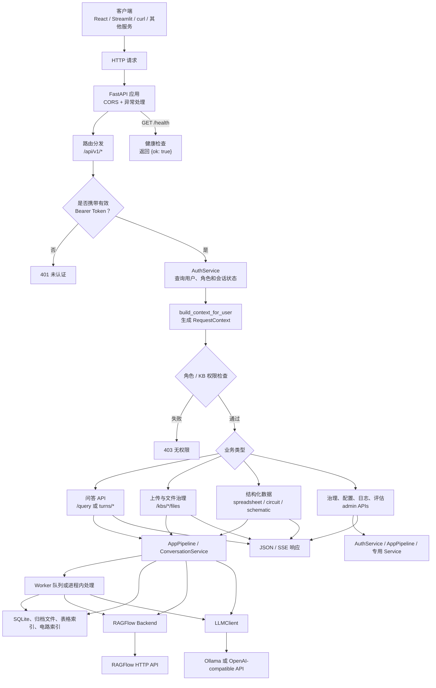
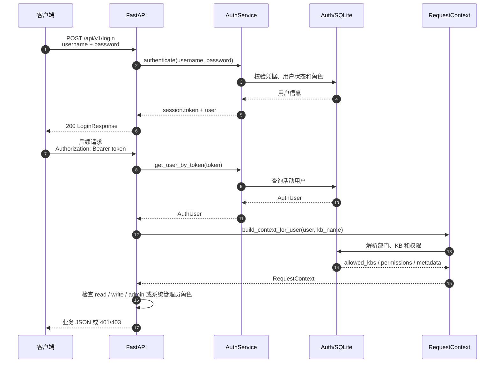
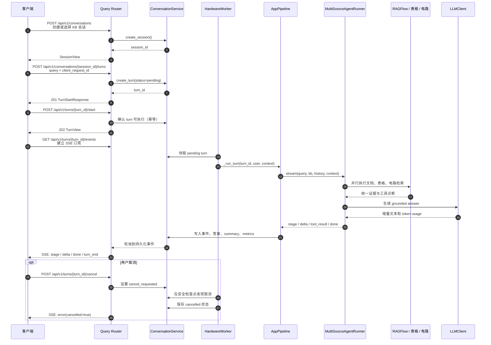
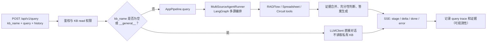
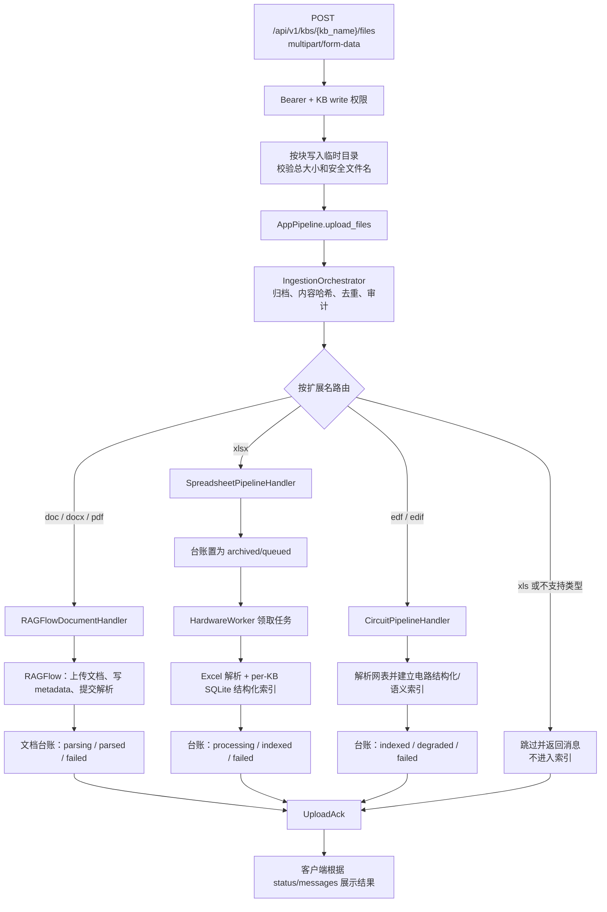

# Hardware DataBase API 调用与使用流程

> 本文描述当前 `src/api/` FastAPI 服务的调用入口、鉴权边界、核心业务流程以及各模块职责。
> 文档对应实现以 `src/api/app.py`、`src/api/routes/`、`src/api/deps.py` 和 `src/workers/main.py` 为准。

## 1. API 基本信息

| 项目 | 说明 |
| --- | --- |
| 服务启动命令 | `uv run hardware-database-server` |
| 默认地址 | `http://127.0.0.1:8001` |
| 健康检查 | `GET /health`，不需要登录 |
| 业务 API 前缀 | `/api/v1` |
| 在线接口文档 | `/docs`（Swagger UI）、`/redoc`、`/openapi.json` |
| 认证方式 | 登录后在请求头携带 `Authorization: Bearer <token>` |
| 流式响应 | 问答接口使用 Server-Sent Events（SSE），媒体类型为 `text/event-stream` |

API 层只负责 HTTP 参数转换、鉴权、权限上下文组装和响应格式化，不在路由中重复实现业务逻辑。客户端应调用本服务，不应直接调用 RAGFlow 或 LLM 服务。

## 2. 总体调用流程图



独立 PNG 图片：[`api_call_usage_flow.png`](./api_call_usage_flow.png)

### 2.1 各部分功能

| 部分 | 主要功能 | 代码位置 |
| --- | --- | --- |
| 客户端 | 发起登录、文件上传、查询、轮询、SSE 订阅和管理操作 | `frontend/` 或外部调用方 |
| FastAPI 应用 | 创建应用、注册 `/api/v1` 路由、配置 CORS、安装异常处理器 | `src/api/app.py` |
| 路由层 | 将 HTTP path/query/body 转换为领域服务调用，并将结果转换为 DTO | `src/api/routes/` |
| `AuthService` | 校验用户名密码、解析 Bearer Token、读取用户角色和启用状态 | `src/core/auth.py` |
| `RequestContext` | 固定用户、部门、知识库和权限范围，供后续服务执行隔离 | `src/api/context.py`、`src/pipelines/document_rag/schemas.py` |
| `AppPipeline` | 统一承接知识库、文件上传、查询、删除和多源检索入口 | `src/core/app_pipeline.py` |
| `ConversationService` | 持久化会话、turn、消息和事件，支持断线恢复 | `src/core/conversation.py` |
| `HardwareWorker` | 领取待处理对话 turn 和表格解析任务，执行耗时工作 | `src/workers/main.py` |
| 多源 Agent | 拆解问题、规划来源、调用文档/表格/电路工具并生成答案 | `src/agents/runner.py`、`src/agents/graph.py` |
| RAGFlow Backend | 普通文档上传、解析、检索、删除及远端状态同步 | `src/pipelines/document_rag/ragflow_backend.py` |
| 结构化 Pipeline | 将 Excel、EDF/EDIF 等文件转换为可查询的结构化索引 | `src/pipelines/spreadsheet/`、`src/circuit/` |
| `LLMClient` | 统一调用 Ollama 或 OpenAI-compatible LLM，并处理流式输出、重试和回退 | `src/core/llm_client.py` |
| 持久化层 | 保存用户、权限、会话、台账、解析状态、查询 trace 和证据 | `storage/` 下的 SQLite、归档和索引 |

## 3. 认证与权限流程



规则要点：

1. `POST /api/v1/login` 不需要 Bearer Token；成功后返回 token。
2. 除登录和 `GET /health` 外，业务接口默认需要 Bearer Token。
3. `RequestContext` 是权限边界的统一来源，包含用户、部门、当前 KB、可访问 KB 和权限元数据。
4. `system_admin` 是治理角色，不能读取部门知识库内容；知识库内容通常由 `user` 或 `dept_admin` 按 KB 权限访问。
5. 权限不足时应由客户端停止后续调用，并向用户展示接口返回的 `detail`，不要自行绕过权限重试。

## 4. 问答调用流程

当前提供两种问答方式。新客户端推荐使用“持久化 turn + SSE 事件”方式；`POST /query` 适合兼容现有流式调用或简单客户端。

### 4.1 推荐方式：持久化 turn + Worker + SSE



调用顺序：

1. 登录并取得 token。
2. 使用 `POST /api/v1/conversations` 创建会话，或复用已有 `session_id`。
3. 使用 `POST /api/v1/conversations/{session_id}/turns` 创建 turn。
4. 使用 `POST /api/v1/turns/{turn_id}/start` 确保 turn 进入执行流程。
5. 使用 `GET /api/v1/turns/{turn_id}/events` 订阅事件；断线后可通过 `after` 参数或 `Last-Event-ID` 继续读取。
6. 使用 `GET /api/v1/turns/{turn_id}` 查看最终状态，或使用 `POST /api/v1/turns/{turn_id}/cancel` 请求取消。

常见事件：

| 事件 | 功能 |
| --- | --- |
| `turn_start` | 标记本轮对话开始 |
| `stage` | 报告问题分析、检索、生成等阶段及状态 |
| `tool_result` | 返回工具调用结果摘要或诊断 |
| `delta` | 增量回答文本，客户端应按顺序拼接 `text` |
| `done` | 本轮完成，包含 `turn`、`answer`、`summary` 等信息 |
| `error` | 报告失败、取消或 Worker 失联 |
| `turn_end` | 标记终态，通常为 `completed`、`cancelled` 或 `failed` |

### 4.2 兼容方式：`POST /api/v1/query` 直接流式返回



该方式的特点：

- 返回 `text/event-stream`，客户端应使用支持流式读取的 HTTP 客户端，例如 `curl -N`。
- `kb_name` 为空或为 `__general__` 时只调用 LLM，不声称读取了私有知识库。
- 知识库问答会经过 Agent 的问题分析、来源规划、多源检索、证据评估和 grounded answer 流程。
- API 进程使用生产者线程执行同步查询生成器，异步 HTTP 侧只负责转发事件和处理断开。
- 查询结果会记录 query trace 和检索证据，但此接口本身不创建持久化会话 turn；需要断线恢复时使用 4.1 的方式。

## 5. 文件上传与索引流程



| 文件类型 | 处理器 | 调用后的状态重点 | 查询入口 |
| --- | --- | --- | --- |
| `.doc` / `.docx` / `.pdf` | RAGFlow 文档 pipeline | 通常先为 `parsing`，远端完成后变为终态 | Agent 的 `DocumentRAGTool` |
| `.xlsx` | Spreadsheet pipeline | 先归档，再由 Worker 异步解析为 `indexed` 或 `failed` | Spreadsheet tools / structured API |
| `.edf` / `.edif` | Circuit pipeline | 上传阶段解析并建立电路索引，可为 `indexed`、`degraded` 或 `failed` | `CircuitQueryTool` / structured API |
| `.xls` | 显式拒绝 | 返回 skipped，不执行索引 | 无 |
| 其他扩展名 | 无匹配 pipeline | 返回 skipped，并说明不支持 | 无 |

上传成功只表示文件已被接收并提交对应 pipeline，不等于所有远端解析都已完成。需要查看状态时使用：

- `GET /api/v1/kbs/{kb_name}/files`：查看文件台账和当前状态，适合普通读用户。
- `GET /api/v1/kbs/{kb_name}/parse-tasks`：查看解析任务进度，要求 KB `write` 权限。
- `GET /api/v1/kbs/{kb_name}/files/{file_id}/chunks`：读取文档解析结果，适合需要查看 chunk 的场景。

## 6. 接口分组与功能

下表按路由 tag 汇总接口用途；完整参数和响应模型以 `/docs` 或 `src/api/schemas.py` 为准。

| 分组 | 代表接口 | 功能 | 典型权限 |
| --- | --- | --- | --- |
| 认证 | `POST /login`、`GET /whoami`、`POST /logout` | 登录、读取当前用户、撤销会话 | 登录除外，其余需登录 |
| 知识库 | `GET /kbs`、`POST /kbs`、`DELETE /kbs/{kb}` | 列出、创建和删除知识库 | `read` / `admin` / `dept_admin` |
| 文件与上传 | `GET /kbs/{kb}/files`、`POST /kbs/{kb}/files`、`DELETE .../files/{file}` | 文件台账、上传、删除和归档治理 | `read` / `write` / `admin` |
| 解析任务 | `GET .../parse-tasks`、`pause`、`resume`、`DELETE` | 查看、清理或控制解析任务 | 通常要求 `write` |
| 会话 | `/conversations` 及其 `messages` 子路径 | 会话创建、列表、消息读取和清理 | 用户自己的历史 + KB read |
| 问答 | `POST /query`、`POST /conversations/{id}/turns`、`GET /turns/{id}/events` | 直接 SSE 问答或持久化 turn 问答 | KB `read` |
| 结构化数据 | `/structured/spreadsheets`、`/structured/circuit-designs`、`/structured/schematics` | 查看表格、电路和原理图解析结果 | KB `read` |
| 硬件资产 | `/assets`、`/asset-candidates` | 查看资产、生成候选、接受或拒绝候选 | KB 内容权限及写权限 |
| 文档生成 | `/document-generation/*` | 模板分析、工作单、生成任务、产物预览/下载和审批 | 按 KB/工作单权限 |
| 部门与用户 | `/departments`、`/users` | 部门、用户、角色和账号状态管理 | `system_admin` / `dept_admin` |
| KB 权限 | `/kbs/{kb}/permissions`、`/assign` | 授予或撤销用户的 KB 权限 | 管理员 |
| 治理 | `/governance/*` | 汇总 KB、文件和异常状态 | `system_admin` |
| 配置与依赖健康 | `/config`、`/health/ragflow`、`/health/llm` | 读取脱敏配置、更新白名单配置、检查外部依赖 | `system_admin` |
| 日志与指标 | `/logs/audit`、`/logs/query`、`/task-metrics` | 审计日志、查询 trace、证据详情和任务指标 | 管理员/部门范围 |
| 评估 | `/evaluation/*` | 创建、启动、暂停、恢复、取消和比较 RAGAS 评估 | `system_admin` |

## 7. Worker 与外部 API 的关系

### 7.1 Worker 生命周期

API 服务启动时默认由 `lifespan` 自动拉起 `python -m src.workers.main` 子进程。Worker 每轮执行两类工作：

1. 从会话数据库领取待处理的聊天 turn，调用 `_run_turn` 执行问答并持久化事件。
2. 从 pipeline 任务队列领取表格解析记录，执行 Excel 解析和索引。

多实例部署时建议设置 `HDB_API_SPAWN_WORKER=0`，再单独运行一个或多个受控 Worker，避免多个 API 进程各自抢占同一个 SQLite 队列：

```bash
HDB_API_SPAWN_WORKER=0 uv run hardware-database-server
uv run hardware-database-worker
```

### 7.2 外部 HTTP 调用

| 外部系统 | 调用方 | 典型接口 | 作用 |
| --- | --- | --- | --- |
| RAGFlow | `RAGFlowClient` / `RAGFlowBackend` | `GET/POST /api/v1/datasets`、`POST .../documents`、`POST .../chunks`、`POST /api/v1/retrieval` | 文档 dataset 管理、上传解析和检索 |
| Ollama | `LLMClient` | `POST {AGENT_OLLAMA_BASE_URL}/api/chat` | 本地模型对话、工具调用和流式生成 |
| OpenAI-compatible LLM | `LLMClient` | `POST {AGENT_CUSTOM_BASE_URL}/chat/completions` | 远程兼容模型、流式生成、429 重试和模型回退 |

这些外部 API 的 Key、Base URL 和模型配置由后端读取 `.env` / `config/settings.py`。浏览器客户端只需要调用 Hardware DataBase API，不应把 `RAGFLOW_API_KEY` 或 `AGENT_CUSTOM_API_KEY` 下发到前端。

## 8. 常用调用示例

以下示例假设 API 地址为 `http://127.0.0.1:8001`，请将 `<TOKEN>`、`<KB_NAME>` 和文件路径替换为实际值。

### 8.1 登录和查看可用知识库

```bash
curl -s -X POST http://127.0.0.1:8001/api/v1/login \
  -H 'Content-Type: application/json' \
  -d '{"username":"<USERNAME>","password":"<PASSWORD>"}'

curl -s http://127.0.0.1:8001/api/v1/kbs \
  -H 'Authorization: Bearer <TOKEN>'
```

### 8.2 上传文件

```bash
curl -s -X POST \
  'http://127.0.0.1:8001/api/v1/kbs/<KB_NAME>/files' \
  -H 'Authorization: Bearer <TOKEN>' \
  -F 'files=@./design.pdf' \
  -F 'source_group=design'
```

响应中的 `success_count`、`failed_count`、`skipped_count` 和 `messages` 用于展示本次批量上传结果；解析完成状态需要另外查询文件或解析任务接口。

### 8.3 使用持久化 turn 问答

```bash
# 1. 创建会话，响应中取得 session.id
curl -s -X POST http://127.0.0.1:8001/api/v1/conversations \
  -H 'Authorization: Bearer <TOKEN>' \
  -H 'Content-Type: application/json' \
  -d '{"kb_name":"<KB_NAME>","title":"电源设计查询"}'

# 2. 创建 turn，响应中取得 turn.id
curl -s -X POST \
  'http://127.0.0.1:8001/api/v1/conversations/<SESSION_ID>/turns' \
  -H 'Authorization: Bearer <TOKEN>' \
  -H 'Content-Type: application/json' \
  -d '{"query":"请查找 TPS5430 的设计注意事项","client_request_id":"req-001"}'

# 3. 触发/确认执行
curl -s -X POST \
  'http://127.0.0.1:8001/api/v1/turns/<TURN_ID>/start' \
  -H 'Authorization: Bearer <TOKEN>'

# 4. 订阅持久化 SSE 事件
curl -N \
  'http://127.0.0.1:8001/api/v1/turns/<TURN_ID>/events?after=0' \
  -H 'Authorization: Bearer <TOKEN>'
```

### 8.4 直接流式问答

```bash
curl -N -X POST http://127.0.0.1:8001/api/v1/query \
  -H 'Authorization: Bearer <TOKEN>' \
  -H 'Content-Type: application/json' \
  -d '{
    "kb_name":"<KB_NAME>",
    "query":"请总结该知识库中的电源设计约束",
    "history":[],
    "thread_id":"client-thread-001"
  }'
```

## 9. 响应、异常和重连约定

| 状态码 | 含义 | 客户端处理建议 |
| --- | --- | --- |
| `200` | 查询或读取成功 | 解析 JSON；SSE 则持续读取事件 |
| `201` | 已创建会话或 turn | 保存返回的 `session_id` / `turn_id` |
| `202` | 已接受异步执行 | 订阅 SSE 或轮询状态 |
| `400` | 参数或业务状态不合法 | 展示 `detail`，修正请求后再试 |
| `401` | Token 缺失、无效或用户已失效 | 重新登录，不要复用旧 Token |
| `403` | 角色或 KB 权限不足 | 请求管理员授权或切换正确账号 |
| `404` | 资源不存在或不属于当前用户 | 刷新资源列表并检查 ID/KB |
| `413` | 上传总大小超过限制 | 拆分文件或调整后端上传上限 |
| `422` | Pydantic 请求体校验失败 | 按 `/docs` 中的 schema 修正 JSON/form-data |
| `500` | 服务内部异常 | 结合 `/logs`、Worker 日志和外部依赖健康接口排查 |

SSE 客户端应注意：

- 使用 `event` 字段判断事件类型、`data` 字段解析 JSON；不要把整行文本直接当作答案。
- `delta.text` 需要按顺序拼接；收到 `done` 后保存完整答案和摘要。
- 断线重连时使用上一次收到的 SSE `id` 设置 `Last-Event-ID`，或将序号放入 `after` 参数。
- 收到 `turn_end` 或终态 turn 后停止重试；收到 `error` 时根据 `cancelled`、`worker_lost` 等字段决定提示或重新提交。

## 10. 代码导航

| 需要了解的内容 | 首选文件 |
| --- | --- |
| 应用创建、路由注册、CORS、Worker 自动启动 | `src/api/app.py` |
| Token 解析、用户依赖、角色依赖、KB 内容隔离 | `src/api/deps.py` |
| API 用户到统一权限上下文的转换 | `src/api/context.py` |
| 请求/响应 DTO 和字段约束 | `src/api/schemas.py` |
| 持久化 turn、SSE、直接 `/query` | `src/api/routes/query.py` |
| 会话和消息管理 | `src/api/routes/conversations.py` |
| 文件上传临时落盘和大小限制 | `src/api/routes/upload.py` |
| 知识库/文件管理 | `src/api/routes/kbs.py`、`src/api/routes/files.py` |
| 解析任务控制 | `src/api/routes/parse_tasks.py` |
| 异步 turn 和表格任务执行 | `src/workers/main.py` |
| 多源查询和上传统一入口 | `src/core/app_pipeline.py` |
| RAGFlow 外部 API 封装 | `src/pipelines/document_rag/ragflow_backend.py` |
| LLM 外部 API 封装 | `src/core/llm_client.py` |
