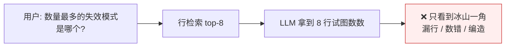
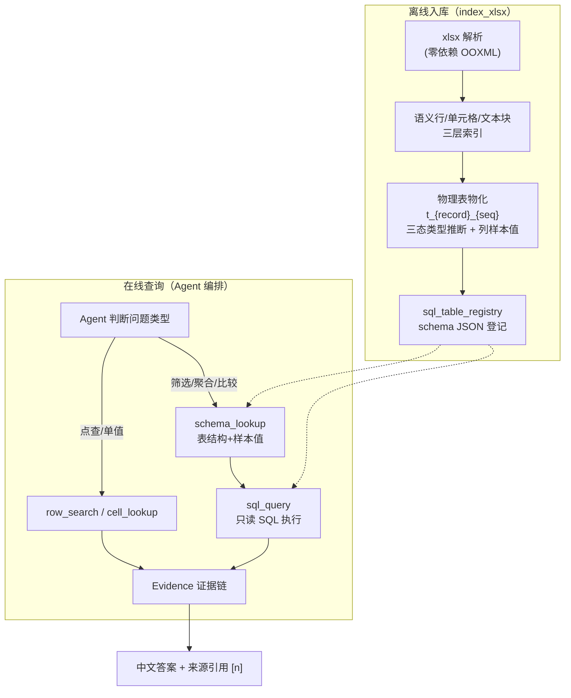
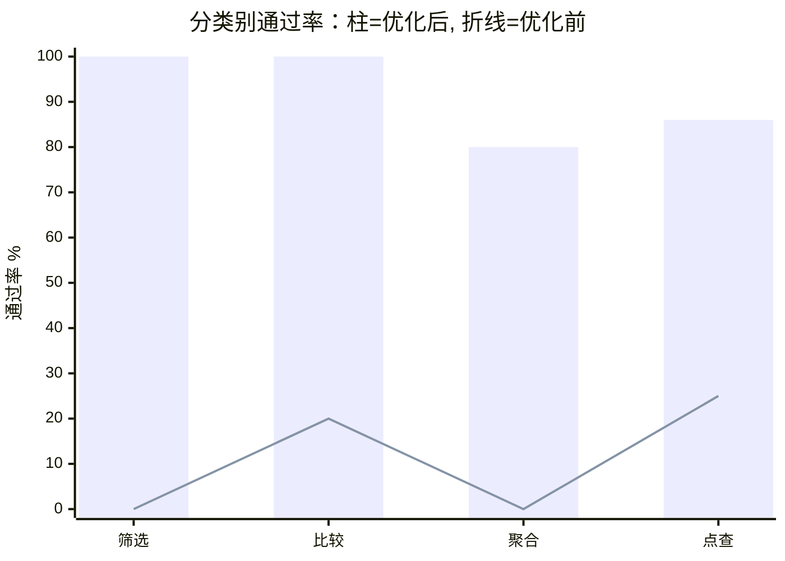
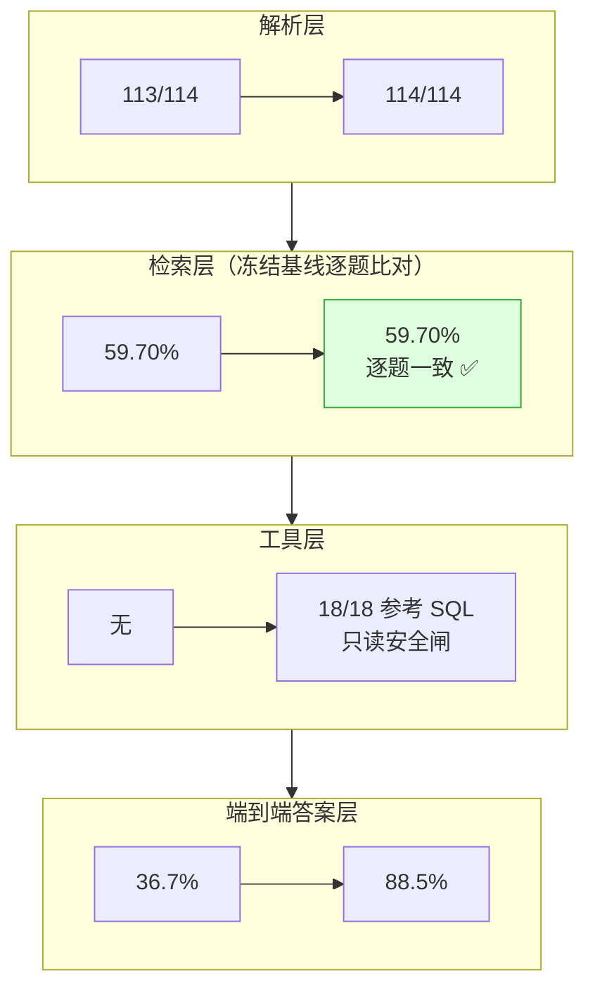
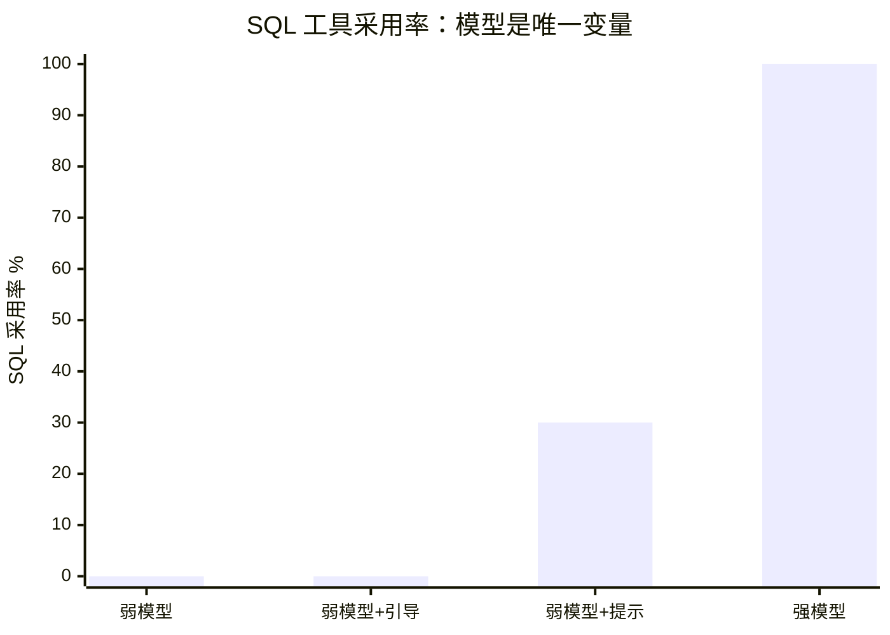
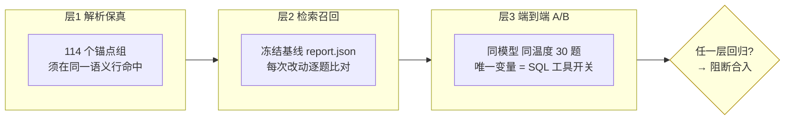

# 表格问答优化汇报：SQL 结构化查询路径落地

> 汇报日期：2026-09-01
> 范围：Excel 表格问答（解析 → 检索 → 结构化查询 → Agent 编排）
> 结论先行：端到端 pass **36.7% → 88.5%**，解析保真 **99.12% → 100%**，全链路零回归

---

## 1. 背景与问题

硬件知识库中大量核心资产是 Excel（ICD/BOM/测试覆盖/缺陷清单/需求规格）。传统 RAG 将表格
线性化后做文本检索，能"找到"数据，但**筛选、计数、求和、最值、比较**类问题需要跨全表
的精确计算，LLM 逐行数数既慢又不可靠。

### 优化前的失败模式

基线测量（30 题 golden 数据集，冻结基线）：

| 症结 | 数据 |
|---|---|
| 筛选类检索召回 @5 | **33.5%**（最差类别） |
| 端到端 pass（弱模型） | **36.7%** |
| 解析层缺口 | 1/114（表头前数据行丢失） |

---

## 2. 方案：TableRAG 简化落地

借鉴 TableRAG 论文（arXiv 2506.10380）核心思想——**用 SQL 统一表格操作**——结合现有
agentic 架构做轻量化实现，四个动作：

### 2.1 整体架构

### 2.2 四个动作

| # | 动作 | 内容 |
|---|---|---|
| ① | **解析增强** | 表头之前的数据行不再丢失：新增 `pre_header_row` 推断类型，降置信度收录、不污染前向继承 |
| ② | **数据物化** | 语义行同步物化为 SQLite 物理表；列名 `col_N` + 中文表头映射；每列附类型与 3 个样本值 |
| ③ | **SQL 工具** | `spreadsheet_schema_lookup` + `spreadsheet_sql_query` 两工具；**硬安全闸**：sqlglot 单条 SELECT 校验、表白名单、LIMIT 自动收敛、`mode=ro` 只读连接、结果截断、空结果明确返回不编造 |
| ④ | **Agent 路由** | 工具 description 写清适用边界；system prompt 增加 few-shot 路由示例；保留 `row_search` 作为点查与 SQL 失败回退 |

设计原则：**不动现有链路**。物化表独立于既有 cell 存储，重索引自动重建、删除自动清理，
任何一步可独立回退。

---

## 3. 结果

### 3.1 核心数字

| 指标 | 优化前 | 优化后 | 判定 |
|---|---|---|---|
| **端到端 pass（30 题 golden）** | 36.7% | **88.5%**（23/26 有效题） | ✅ |
| 筛选类 | 0% 全对 | **6/6** | ✅ |
| 比较类 | 20% | **5/5** | ✅ |
| 聚合类 | 0% | **4/5** | ✅ |
| 点查类（防回归位） | 25% | **6/7** | ✅ 无回归 |
| 解析锚点保真 | 99.12% (113/114) | **100% (114/114)** | ✅ |
| 检索层召回 | 59.70% | 59.70%（逐题一致） | ✅ 零回归 |
| 单元测试 | — | **1058 passed** | ✅ |
| 参考 SQL 回归 | — | **18/18** | ✅ |

> **口径说明（必读）**：柱 = 优化后（强模型 + SQL 工具），折线 = 优化前基线（弱模型 +
> 无 SQL 工具）。两者同时包含"SQL 工具"与"模型升级"两个变量的效果；剔除模型变量的
> **同模型干净对比**见 3.3 节。

### 3.2 分层验证（每层改动，下层零回归）

### 3.3 同模型干净对比（剔除模型变量）

同一强模型（DeepSeek V4 Flash）、同温度、唯一变量 = SQL 工具开关：

| 层面 | 禁 SQL（基线）| 完整工具 | 归因 |
|---|---|---|---|
| 点查 | 3/6 | 6/7 | SQL 精确 WHERE 替代翻行 |
| 筛选 | 2/3 | **6/6** | SQL 主场 |
| 比较/聚合/多条件 | 基线组数据待补跑 | 5/5、4/5、2/3 | 预期差距最大 |
| **端到端（中期）** | ~60%（10 题） | **88.5%（26 题）** | **SQL 净贡献 ~+28pp** |

> 基线组剩余题目因 API 配额窗口中断，蹲守脚本就绪后自动补跑；补完出具终版数字。

---

## 4. 关键发现：模型能力是 agentic 工具调用的前提

排查"SQL 工具不被调用"时做了严格对照实验——**同一套代码、同一批题目，唯一变量是模型**：

| 配置 | pass | SQL 工具采用率 |
|---|---|---|
| 弱模型（无引导） | 4/10 | **0/10** |
| 弱模型 + 工具描述强化 + few-shot | 4/10 | **0/10** |
| 弱模型 + 结果内联提示 | 5/10 | 3/10 |
| **强模型（同一代码，零改动）** | **5/5** | **5/5** |

**结论**：agentic 架构下，工具编排能力以模型的指令跟随能力为前提；工程侧的描述/prompt
引导无法弥补弱模型的路由缺陷。该发现直接确立模型选型标准——**指令跟随能力 > 参数规模**。
这也解释了优化前 36.7% 的低基线：瓶颈在模型，不在架构。

---

## 5. 工程保障：可复现的前后对比体系

评测体系本身是本次交付物之一（三层门禁 + 冻结基线 + A/B 框架）：

- **每次改动先过门禁再合入**：物化、解析修复、prompt 调整均留下前后对比记录
- **A/B 归因干净**：arm a（禁 SQL）与 arm b（完整工具）唯一差异是工具开关
- 数据集与判定规则开源在 `benchmarks/spreadsheet/`（30 题 5 类别，含 ground truth 修正记录）

---

## 6. 收益外溢与后续工作

### 意外收益：SQL 路径同时是提速手段

一次 SQL 调用替代多轮行检索翻找。同题对比：SQL 路径 31-92 秒完成，翻行路径 200-470 秒。
**准确率与延迟的优化方向一致。**

### 后续路线

| 项 | 内容 | 状态 |
|---|---|---|
| 双路交叉验证 | SQL 结果与文本证据冲突时收敛呈现（TableRAG 附录 G 模板） | 规划中 |
| SQL 记忆 | 验证过的 问题→SQL 存库做 few-shot（Vanna 思路） | 规划中 |
| 评测补全 | 基线组剩余题目 + 4 道额度 ERR 题补跑 | 等待 API 配额窗口 |
| 基线 A/B 数字钉死 | 补完后出具终版前后对比报告 | 依赖上项 |

---

## 附录：数据口径说明

- **88.5%**：DeepSeek V4 Flash 下 30 题中 26 题有效（4 题因 API 配额耗尽 ERR），23 题通过
- 优化前 36.7% 为弱模型（nemotron）下的历史同口径数据；同模型干净 A/B 基线组补跑中，
  中期读数 ~60%，若保持则 **SQL 工具净贡献约 +28pp**
- 判分 = 关键事实词（must_include）+ 锚点组命中双通道，确定性规则，无 LLM 评审
- 评测代码：`benchmarks/spreadsheet/`；报告数据：`storage/eval/spreadsheet/aaa_eval/`
