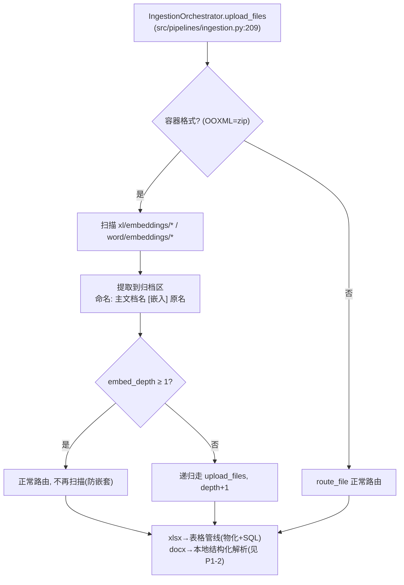

# Hardware-DataBase 优化路线图

> 更新日期：2026-09-16（P0 执行记录见 P0 段）
> 前置状态：SQL 结构化查询路径已落地（统一 k=3 干净 A/B：36.7%→100%，稳定失败 19→0，见 P0 执行记录），
> 代码已提交 `feature/spreadsheet-sql` 分支。本文档沉淀后续优化点与本 session 达成的设计决策。

---

## 0. 设计决策记录（先于路线图，防止反复）

以下原则在本轮优化中已确立并有数据支撑，后续工作不得无据推翻：

| # | 原则 | 依据 |
|---|---|---|
| D1 | **约束分级放权**：安全/资源类约束（只读校验、LIMIT、防嵌套深度）永不放权；策略类约束（全局 vs 定向、先查哪个文件）随模型能力逐步交还模型 | nemotron 路由遵循 0% vs DeepSeek 100%，同代码 |
| D2 | **放权由评测裁判**：每次模型升级重跑 golden 集 + 护栏题，达标才放权，不达标加回软引导 | 三层评测体系已建成 |
| D3 | **RAG 与结构化查询是分工不是替代**：叙述性/语义模糊问题归 RAG（语义兜底），结构化/模板化/可计算问题归本地解析+SQL | arm b 通过题的工具轨迹中 RAG 工具仍在链路 |
| D4 | **嵌入 docx 走本地结构化解析，不走 RAGFlow**：RAGFlow 的 chunk 检索原理上不保层级结构、丢 docx 内表格，且无法承载"选型对比"类模板化结构问答 | RAGFlow 产品能力评估 + 嵌入 Word 实测（14 个模板化模块文档） |
| D5 | **亲子文档关联写进行文本**：`parent_context_stamp` 焊进每条语义行前缀，不依赖外部 join（库级 parent_document 列与命名规范为辅助层） | "此文档是..."类自述上下文断链问题 |
| D6 | **定向检索是 opt-in 精修**：参数可选、默认全局、结果标注边界、名称不可信（定向依据=全局探针命中分布，非文件名猜测） | 过度定向/全局污染双向风险 |
| D7 | **一切优化过三层评测门禁**：解析保真→检索召回（冻结基线逐题比对）→端到端 A/B，任一层回归阻断合入 | 本轮全链路零回归的实践 |

---

## P0：收口当前战果（1 天内）

### P0-1 AG01 题面歧义修复
- **问题**：题面"并联电阻一共有几个"存在 9（位号数）vs 23（连接行数）两种合理解读；DeepSeek 终局答 9 被判 MISS（判分正确，非判分器 bug），probe 时答 23 判 PASS——同题两次结果分叉
- **方案**：改题面消歧 → "GND 到 PGND 的并联**连接一共有多少行**？"；同时全面审查 30 题题面同类歧义
- **不采用**：双答案口径（降低评测严格性，掩盖口径模糊）
- **验收**：改后重跑答案层，AG01 结果稳定唯一
- 工作量：0.5h

### P0-2 评测补跑收口
- **内容**：① arm b 的 4 道额度 ERR 题（PL01/FL07/MC04/MC02）② arm a 基线剩余 19 题
- **依赖**：opencode Go 套餐 5h 额度窗口（$12/5h，arm a 无 SQL 漫游耗额度大，建议 workers=2）
- **验收**：终版报告：同模型干净 A/B 的分类型 delta 表（当前中期读数：基线 ~60% vs 88.5%，SQL 净贡献 ~+28pp）
- 工作量：等待窗口 + 2h 机器时间

### P0-3 判分边界全面审查
- **内容**：扫描全部 30 题 pass 判定，排查"锚点全中但 MISS"类口径问题；发现 AG01 型题一并修
- 工作量：1h

### P0 执行记录（2026-09-16）

- **P0-1 完成**：AG01 题面改为「Page2 里 GND 到 PGND 的并联连接一共有多少行？」（golden_qa v1.1，truth_note 记录消歧原因）；答案层 `--arm b --ids AG01 --force` 连续两次 PASS（均明确答「23 行」，8.7s / 8.1s），结果稳定唯一。
- **评测脚本修复**：`run_answer_eval.py` 数据集路径 `evals/spreadsheet/` 已不存在 → 指向 `benchmarks/spreadsheet/golden_qa.json`；新增 `--force --ids` 单题重跑（先清 checkpoint）与 `--arm rescore`（按新判分规则重算归档答案，不重跑模型）。
- **冻结基线重生成**：旧 `baseline_report.json` 早于解析器修正（7 个文件的 semantic_row_count 全部漂移、PL01 解析命中 0/1）；已存档为 `baseline_report_20260831.json`，并按 v1.1 数据集 + 当前解析器重生成（解析 114/114，q-recall@5 0.597→0.6304）；层 1/2 两次重跑字节一致（确定性已验证）。
- **P0-3 完成**：有效作答中「锚点全中但 MISS」仅 AG01，已由 P0-1 修复。误 PASS 风险已收紧：must_include 支持 `REGEX:` 前缀（AG02 `8[个项]`、AG03 `3[路条]`、AG01 `23` 数字边界、FL07/MC04 `HW-REQ` 防 `HW-REQ-20` 误配）；重算后 arm a 11→9（剔除 2 个误 PASS），arm b 不变。
- **P0-2 完成（终版干净 A/B）**：先修复两处评测环境问题——agent 侧表格索引仍是 8-31 旧解析（缺 PL01 行、7 文件行数全漂移）已重建；eval harness 未写目录账本导致 `list_kb_sources` 误报「表格 0」已补登记。随后 30 题全量同模型（temperature=0、fresh index、修复 harness）：
  - **arm a（无 SQL）9/30 = 30.0%；arm b（SQL）24/30 = 80.0%；SQL 净贡献 +50.0pp**；事实覆盖（anchor_ratio）24.4% → 59.1%；arm b SQL 使用 26/30。
  - 与 9-01 中期读数（~60% vs 88.5%，+28pp）不可直接比较：终版为 fresh 索引 + 修复目录账本 + 收紧判分后的读数，中期读数存在旧索引与误 PASS 污染。
  - arm b 剩余 6 MISS 稳定复现（重跑仍 MISS），归因三类：**目录误判** MC02/FL03（目录显示「电路 0」后放弃表格查询，prompt/工具引导问题）；**步数上限** MC04/MC05（MC04 单题 ~9 分钟）；**检索未命中** PL04/PL05。
- **即修项执行（2026-09-16 同 session，按收益排序）**：
  - **目录误判修复**：`.env` SYSTEM_PROMPT 规则 7 增加回退子句（circuit_search 未命中且问题涉表格时改用 spreadsheet_* 查证）+ `circuit_search` 零命中提示 + `list_kb_sources` 说明/输出边界行。定向验证：MC02/FL03/PL05/MC05 转 PASS。
  - **判分鲁棒性**：`_anchor_matches` 支持 `REGEX:` 前缀与中文混合串空白不敏感（模型写「车身 CAN0 高」不再误判 MISS）；`--arm rescore` 重算后 MC03 归位。诊断增强：answer eval 结果落 `retrieval_ledger`/`tool_diagnostics`（trace 可归因）。
  - **终版读数（统一 k=3，pass@k）**：`--repeat 3` 全量（各 90 题次）——**arm a 36.7%（fact 23.4%；稳定通过 6 / 稳定失败 19 / 翻转 5）vs arm b 100%（fact 75.1%；稳定通过 25 / 稳定失败 0 / 翻转 5），SQL 净贡献 +63.3pp**；最弱题 PL04/MC05 仅 1/3 通过。单次全量读数（arm b 90.0%）与 pass@3 的差异说明单次结果受 provider 侧方差影响，门禁应以 pass@k 为准。
  - **方法学升级完成**：`run_answer_eval.py` 新增 `--repeat k`（按题目补齐题次、checkpoint 以 `-r{i}` 隔离、`--force` 清全部题次）与报告增强（pass@k / 稳定通过 / 稳定失败 / 翻转题明细）。
  - **MC04 修复完成（解析器）**：新增 `_section_heading_text`（`table_store.py`）识别「目标类型=章节名称」行并从原始单元格恢复标题，写入独立字段 `section_heading`，只进物化 `section` 列（不写 `semantic_text`，避免改变词法检索排序）；`sql_materializer`/`spreadsheet_tools` 暴露 `section`/`row_index` 附加列并加 SQL 工具引导。**层 1/2 重跑字节一致（零回归）**；MC04 两次 PASS（6/6 锚点，15.0s / 19.6s，SQL 直接 `WHERE section LIKE '%3.1.2%'`）。
- **遗留至 P1/P2**：MC04 答案含 HW-REQ-1 的边界瑕疵（章节标题行跨段前向继承，可选精修：新章节标题行清空前向填充上下文）；PL04/MC05 低通过率（1/3）的长尾归因；嵌入文档 P1-1/P1-2。P0 无阻塞项。

---

## P1：价值补洞（1 周内，最高业务价值）

### P1-1 嵌入文档处理（路由层统一方案）

**问题**：架构说明书.xlsx 内嵌 14 个模块设计 Word（选型论证/方案对比/复用评估——硬件设计核心知识）+1 个嵌入 Excel，当前仅计数不处理，内容完全丢失。

**已定架构（D4/D5）**：

**要点**：
- 扫描点在 `route_file()`（registry.py:87）之前，所有容器格式统一受益
- `pipeline_documents` 加 `embed_depth` / `parent_document` 列（`_ensure_columns` 迁移机制现成，document_store_sqlite.py:163）
- content-hash 去重自动复用；命名含主文档名避免 UNIQUE 冲突
- 单个嵌入失败不影响主文档入库（登记 failed）
- 分支策略：从 `feature/spreadsheet-sql` 拉新分支（嵌入 xlsx 自动享受物化+SQL）

**验收**：架构说明书重新入库后，嵌入清单可见、嵌入 xlsx 可被 SQL 查询、嵌入 docx 可被检索（依赖 P1-2）
工作量：2-3 天

### P1-1 执行进展（2026-09-16）

- **实测修正**：架构说明书内嵌 **17 个对象（16 Word + 1 Excel）**，全部是标准 OOXML（非 OLE `.bin`），stdlib `zipfile` 可直接解包，不需要额外依赖。标题源用正文首段（`docProps/app.xml` 的 titles 为空）。
- **方案调整（据实收敛）**：嵌入 **docx → RAGFlow**（语义检索）；嵌入 **xlsx → 表格管线**（物化 + SQL）；**P1-2 本地 docx 结构化解析暂缓**，改为"评测出现 docx 表内数值/选型对比稳定 MISS 时再补"。代价备忘：docx 内表格大概率随 RAGFlow chunk 丢失。
- **已实现**：`src/ingestion/embedded_extractor.py`（提取 / 首段标题 / 命名 / SHA-256）；`IngestionScope.embed_depth`/`parent_document` + `upload_files` 递归展开（深度 1 截断、单子失败隔离、父引用登记）；`pipeline_documents` 新增 `embed_depth`/`parent_document`（JSON 父列表）列与 `update_embedding_meta`/`add_parent_reference`/`list_embedded_children`/`remove_parent_reference` 方法；单测 21 项通过。
- **命名规则**：`父名 [嵌入] 正文首段标题.ext`，同父内重名追加 `#hash6`；`original_file_name` 保留原名（`Microsoft_Word_DocumentN.docx`）。判重始终按内容 hash，不按名字。
- **已完成（含级联删除与回填）**：`_delete_embedded_children`（删父时移除引用，孤儿才走远端+索引+归档+台账的完整删除，fail-soft）；reuse 分支在无子记录时补展开（P1-1 之前入库的存量父文档，重新上传即回填）。
- **真实入库验收通过（本机 RAGFlow）**：上传架构说明书 → 18 条记录（1 父 + 16 docx + 1 xlsx，全部带父引用）→ 嵌入 docx 检索命中「MCU 选型方案对比」等原文内容（此前完全丢失）→ 嵌入 xlsx 物化为 `t_158_1`（30 行，SQL COUNT 可查）→ 删除父文档级联清理 17 个子记录，远端设计数据集、本地表格索引、归档目录全部清零。
- **观察**：RAGFlow chunk 保留了部分章节标题（如「5.7.3 MCU温度采集」），叙述性/选型文本可检索；docx 内表格仍可能丢失（P1-2 触发条件）。真实链路本地解析状态不自动刷新（项目已知限制），验收时按生产语义同步后检索。
- **验收后注意**：生产部署需保证表格解析 worker 常驻（本次验收中跨进程单次驱动了 `runtime.process_record`）。
- **验收遗留项复核（2026-09-16 晚）**：
  - ① **worker 常驻**：复核确认是已有能力而非缺陷——`hardware-database-server` 默认自动拉起居留 worker（`HDB_API_SPAWN_WORKER=1`，多实例部署可置 0 并单独跑 `hardware-database-worker`）；上传时若 worker 心跳过期，返回消息会带可见告警（`_worker_liveness_warning`）；进程崩溃/重启后由 stale-claim 重排队兜底。本次验收为脚本直连 backend（未起服务），所以需要手动驱动。**无需改代码**。
  - ② **解析状态不刷新**：已修复。`RAGFlowBackend.refresh_parse_statuses` 按 `RAGFLOW_STATUS_REFRESH_MIN_SECONDS`（默认 60s）节流，把仍在 parsing/uploaded 的 RAGFlow 记录状态与远端对齐（done → parsed、failed → failed+错误信息、不可读 → 仅记录检查时间）；store 新增 `list_status_refresh_candidates`/`mark_status_checked`；standalone worker 每轮调用。单测 3 项，并已真实上传验证 parsing→parsed 自动落库。

### P1-2 嵌入 docx 本地结构化解析

**问题**：嵌入 docx 若走 RAGFlow：章节层级丢失、docx 内表格（结温统计/复用统计）丢失、"选型对比"模板结构无法问答（D4）。

**方案（零依赖，复用现有件）**：
1. 解 `word/document.xml`：标题层级树（w:pStyle Heading → section path，如 `5.5.1 CAN总线模块 > 5.5.1.2 选型方案对比`）
2. 按标题切块（超 1200 字截断续块）
3. docx 内表格（w:tbl）复用语义行解析——甚至可物化+SQL
4. 入 `table_semantic_rows`，`inference_type='embedded_doc'`，每行 semantic_text 带 `parent_context_stamp`：
   `[AA250004 架构说明书 · 嵌入文档 MCU系统方案设计.docx · 5.1.2 MCU选型方案对比] + 内容`
5. confidence='high'（原文文本非推断）

**验收**：golden 新增 3 道 embed 类题（MCU 选型 TC377 / CAN 收发器 TCAN1044 / 散热结温），检索层 top-5 命中 + 答案层引用正确指向嵌入文档
工作量：1-2 天

### P1-3 检索工具定向参数（最小实现）

**问题**：agent 扫目录后无法按文档下钻（除 sql_query 外全是全局池）；嵌入文档入库后同名实体污染会指数放大（14 个模块 doc 都含"选型"）。

**最小实现（红线：不做过度）**：
| 改动 | 内容 |
|---|---|
| `document_search` | +`document_name=""` 参数，透传 `filters["source_names"]`（后端 `_metadata_condition` 管道现成，ragflow_backend.py:272）|
| `row_search` | 同参数 → `_semantic_rows` SQL 加 `AND d.document_name LIKE ?` |
| 诚实零结果 | 定向无命中如实返回（M2 fail-open 对定向已天然跳过，代码现成）|
| 工具描述 | 一句话："可选 document_name：全局结果被同名实体污染或问题明确限定范围时使用" |

**不做**：sheet_name 参数、模糊匹配候选清单机制、cell_lookup 改动、circuit_search、流程强制

**防过度定向防线（D6）**：默认全局不动 / 定向结果标注"[定向: 仅 X 文档，其余 N 份未检索]"（边界可见）/ prompt 软引导不强制 / 护栏题验证
工作量：1h + 单测

### P1-4 真实用户验证（P0 计划遗留，与 P1 并行启动）
- **问题**：全部优化基于自建基准自证；P0 计划"翻真实查询日志统计题型占比→决定投入度"因无用户从未执行
- **做法**：部署给 2-3 个硬件工程师试用两周；收集真实 query 分布（可能 80% 的问题不在现有 5 类别里）；记录命中/未命中与省时数据
- **验收**：一份真实 query 分布报告，重新校准 P2/P3 优先级
- **这是"有没有意义"的最终裁决**：技术验证已完成（88.5% 可审计），业务验证为零

---

## P2：可用性治理（用户反馈后排期）

### P2-1 拒答/置信度机制
- **依据**：剩余 MISS 中模型是"猜了"而非"说不知道"；88% 正确+8% 诚实拒答+4% 错误 > 92% 全硬答（用户信任模型）
- **触发点**：SQL 空结果（已实现不编造）/ 双路证据冲突 / 检索零命中 / 置信分低于阈值 → 明确回答"证据不足"+ 说明缺口
- 验收：拒答的题不误判为错答；该拒答的题拒答率上升

### P2-2 版本时效治理
- **问题**：工程师查到旧版 BOM/需求是事故级风险；文档名带版本号（_0506_）但系统无版本防线
- **做法**：`effective_from/effective_to/approval_status` 字段已建未用（document_store_sqlite.py）→ 入库时解析版本、查询时默认最新版+可声明旧版、同内容多版本冲突提示
- 依赖：真实用户的版本痛点确认（P1-4）

### P2-3 模型升级放权流程
- **依据 D1/D2**：模型能力提升 → 策略约束逐步放权
- **做法**：新模型上线 → 重跑 golden+护栏题 → 达标则撤软引导（如"第一轮全局"建议）→ 不达标回滚引导并记录
- 当前状态：DeepSeek V4 Flash 已通过路由放权验证（100% 采率）；护栏题（反偏差/跨文档综合）随 P1-3 落地

---

## P3：增强项（按需触发）

| 项 | 触发条件 | 内容 | 来源 |
|---|---|---|---|
| P3-1 SQL 记忆 | SQL 路径使用率确认后 | 验证过的 问题→SQL 存库做 few-shot；错题修正 SQL 是现成种子 | Vanna 思路 |
| P3-2 双路交叉验证 | 双路同时可用的场景增多 | SQL 结果与文本证据：一致→直答 / SQL错→用文本 / 冲突→并列来源（TableRAG 附录 G 模板中文化）| TableRAG |
| P3-3 检索层增强（FTS5/向量） | **仅当**点查类在生产暴露不足（当前 6/7） | sqlite FTS5 trigram 或 bge-m3+sqlite-vec（依赖已装）| miss 归因：33 个历史 miss 已被 SQL 消化 32 个 |
| P3-4 跨文档追溯链 | 用户反馈追溯类问题失败率高 | 需求ID↔测试用例↔缺陷 实体级链接表，支撑"影响面分析" | 硬件工作流 |
| P3-5 电路定向过滤 | 电路库文件数增多 | CircuitIndexService.query 的 filters 扩展点（现成）加网表级过滤 | 与 P1-3 同构 |
| P3-6 图片/静态图理解 | 明确需求后 | EMF/PNG（原理图截图）VLM 解析；EMF 转换是前置难点 | 语料中大量存在 |

---

## 远期对照实验（架构级验证）

### Agent 直接读文件 vs 数据基座
- **动机**：OpenCode/Claude Code 类助手可直接打开文件阅读整理，质疑数据基座存在意义
- **实验**：给 DeepSeek agent 原始 AAA 文件 + 文件读取工具，跑同样 30 题，对比准确率/延迟/token 成本
- **预期结论框架**：小语料下直读可能打平甚至更好；基座的护城河在**规模**（语料≫上下文）、**预计算结构**（物化表，agent 直读需重新解析且会数错——AG01 即实例）、**治理**（多部门/去重/生命周期）、**可测性**
- **战略定位**：基座的终局不是与 agent 竞争，而是**成为 agent 的工具**（schema_lookup/sql_query/定向检索 即 MCP 工具形态）；agent 越强，对好工具的需求越强

---

## 死表面清理与 legacy 退出（2026-09-16）

### 已删除
- **legacy 直连 `POST /query`**（含 `QueryRequest`、旧 SSE 路径）：仅测试引用，前端/e2e/评测早已走 turns；删除同时把两条丢失的行为带回 turns——① trace 状态按 answer+summary 推导（P1-9）；② 取消的 turn 补写 trace（`status=failed`）。
- **无消费者的 HTTP 路由**：`POST /doc-assets/backfill`（自动回填路径已覆盖）、`POST /document-generation/harness-runs/{run_id}/agent-decision`、`GET /evaluation/runs/{run_id}/collection-qc`（`GET /runs/{id}` 已带 QC）、`POST /parse-tasks/{task_id}/pause|resume`（RAGFlow 后端不支持、纯 facade）、`POST /conversations/{session_id}/clear`、`GET /task-metrics`（`/system/status` 已含任务计数）。同步清理了对应的 pipeline/document_manager/backend ABC/测试桩 plumbing。
- **删除残骸**：`src/ui/`（仅剩 `__pycache__`）、`src/core/logger.py::set_trace_id`（deprecated shim，0 调用）、`AgentHumanDecisionRequest`。

### 已核验无消费者但**有意保留**（运维/在建功能，勿再判死）
| 路由 | 保留理由 |
|---|---|
| `POST /kbs/{kb}/parse-tasks/requeue-dead-letters` | dead-letter 恢复的唯一操作入口（RAGFlowBackend 有真实实现） |
| `POST /attachments/reparse-stale` | 附件解析回填运维入口（等价于 `hardware-database-maintenance reparse-attachments`，待统一） |
| `GET /attachment-releases/pending` | 候选发布治理的跨会话审核队列，前端审核台未建 |
| `/kbs/{kb}/assets/*`、`asset-candidates/*` | 资产中心 WIP（service 层有测试），等前端接入后再定去留 |

### `legacy_brief_v1` 退出计划
- **现状**：兼容层已工程化——开关 `DOCUMENT_AUTHORING_COMPATIBILITY_CLOSURE_ENABLED`（默认 false，系统配置页可改）+ `CompatibilityClosureError` + 遥测库 `storage/document_authoring_compatibility.sqlite`（`legacy_write` / `legacy_direct_execution` / `new_write` 等事件）+ `evaluate_closure_readiness()` 门槛。
- **退出前置条件**（缺一不可）：
  1. `uv run hardware-database-maintenance compatibility-readiness` 返回 `ready: true`（≥2 次 release observation、备份/恢复校验通过、旧字段只读、无新 legacy 写）；
  2. 遥测中 `legacy_write` 与 `legacy_direct_execution` 连续两个观察期零增长；
  3. 无处于非终态的 `contract_version='legacy_brief_v1'` 会话（`document_generation_sessions`）。
- **执行**：置开关 true → 观察日志中的 `CompatibilityClosureError`（预期仅来自未升级客户端）→ 保留一个 release 的回滚窗口（改回 false 即回滚，兼容层对数据只读）。
- **代码清理（closure 稳定一个 release 后）**：删除 `app_pipeline.py` 的 legacy 分支（1241/1257/1273）、`generation_sessions.py` 的 legacy 校验（38/154/156/271/322）、`agents/tools/document_authoring_tools.py` 的版本判断（287/300/1583）、`api/schemas.py:1231` 默认值、`document_authoring/planning/legacy.py`；保留 CompatibilityStore 作审计只读存储。
- **入口**：`hardware-database-maintenance compatibility-readiness`（exit 0 = ready，1 = 有阻断项，输出 JSON 含各项门槛与事件计数）。

---

## 附：当前资产清单

| 资产 | 位置 | 状态 |
|---|---|---|
| SQL 结构化查询 | `src/pipelines/spreadsheet/sql_materializer.py` + `spreadsheet_tools.py` | 已提交 feature/spreadsheet-sql |
| 三层评测体系 | `benchmarks/spreadsheet/`（与 RAGAS evaluation/ 分离） | 已提交 |
| 冻结基线 | `benchmarks/spreadsheet/baseline_report.json` | 已提交 |
| 优化汇报（6 图） | `docs/excel_sql_optimization_report.md` | 已提交 |
| TableRAG 论文/代码 | `~/Desktop/2506.10380v2.pdf`、`~/Desktop/TableRAG-main.zip` | 仓库外 |
| 评测终局数据 | `storage/eval/spreadsheet/aaa_eval/`（gitignored） | 本地 |
