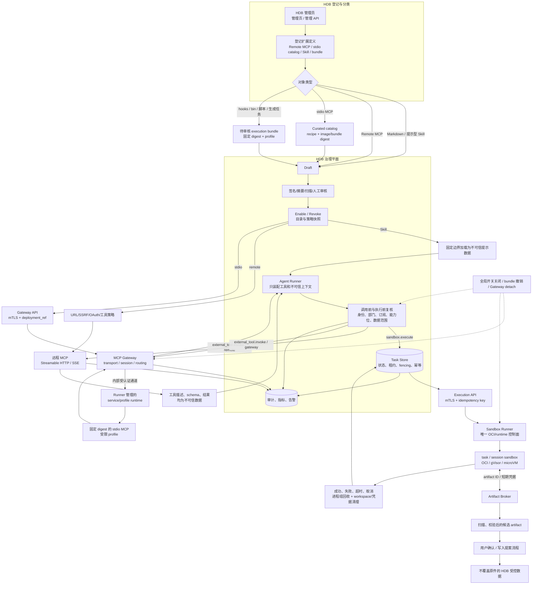

# Hardware-DataBase 外部插件扩展与沙箱优化实施方案

- 日期：2026-09-21
- 修订日期：2026-09-22
- 状态：修订后的实施计划；本文件不代表相关能力已经上线。
- 评审结论：架构有条件通过；P0 设计决策和真实运行时验证完成前，不得进入生产 API 或宣称“首期沙箱能力可用”。
依据：

- `docs/superpowers/plans/2026-09-21-external-general-plugins-mainstream-and-feasible-paths.md`
- `docs/superpowers/plans/2026-09-20-mcp-external-plugin-integration.md`
- 当前 `src/agents/mcp/**`、`src/api/routes/plugins.py` 和前端插件页面

## 0. 执行摘要

### 0.1 最终建议

HDB 不采用“所有插件都由 API/Worker 启动，脚本结束后销毁 Docker 容器”的统一模型，而采用分层架构：

```text
HDB 治理平面
  ├─ 远程 MCP：直接连接远程 Streamable HTTP/SSE 服务
  ├─ stdio MCP：连接独立的 Sandbox MCP Gateway
  └─ Skill 脚本/生成任务：调用独立的 Sandbox Execution Service
```

本方案进一步固定控制面归属：

- **HDB API/Worker 只属于治理平面**，不持有 OCI、Docker、Podman、Kubernetes、gVisor 或 microVM 控制权限；
- **MCP Gateway 负责协议、会话、路由和服务治理**，不直接创建或销毁第三方进程；
- **独立 Sandbox Runner 是唯一的运行时控制面**，同时承载 `task`、`session` 和经审核的 MCP `service/profile` 运行实例；
- Gateway 通过受认证的内部 API/通道请求 Runner 建立或回收 service/profile，HDB 不保存 command、args 或 Docker 参数。

这样既保留了 Gateway 的 MCP transport 能力，也避免 Gateway 和 Runner 同时持有容器控制权限。

核心原则：

1. **HDB API/Worker 不执行第三方代码**，不启动 stdio、shell、Python、Node 或 Docker 子进程。
2. **Docker 是常见的封装和第一层隔离，不自动等于强安全沙箱**。不可信代码、多租户和高敏感数据需要 gVisor、microVM 或等效更强运行时。
3. **MCP server 与脚本任务使用不同生命周期**：MCP 按 server/profile 管理；脚本默认按 task 创建和销毁；多轮 Agent 才使用 session sandbox。
4. **沙箱创建、seccomp、网络、资源限制或超时控制失败时必须 fail-closed**，不得回退到无保护容器。
5. **登记不等于部署，测试不等于启用，启用不等于授权**。现有管理员登记、测试、启用、员工订阅和调用时复核链路继续保留。

### 0.2 接入对象和处理方式

| 对象 | HDB 是否执行 | 推荐运行方式 | 默认生命周期 |
|---|---:|---|---|
| 纯 Markdown/提示型 Skill | 否 | 审核后作为不可信提示数据加载 | 发布版本生命周期 |
| 远程 MCP | 否 | 远程服务自行运行；HDB 做连接、授权和数据外发治理 | 远程服务生命周期 |
| stdio MCP | 否 | 外部 Gateway 路由、Sandbox Runner 托管 service/profile，HDB 仅连接受认证 HTTP endpoint | server/profile 生命周期，可按需启动或闲置回收 |
| 审核过的固定脚本 bundle | 否 | 独立 Sandbox Runner 执行 | task，必要时 session |
| hooks/bin/用户脚本 | 否 | 只能转换为审核过的 bundle；不接受任意命令 | task/session |
| 模型或用户动态生成代码 | 否 | gVisor、microVM 或同等强隔离运行时 | task/session，结束后销毁 |

### 0.3 首期范围和非目标

**首期范围：**

- stdio MCP 通过独立 Sandbox MCP Gateway 接入；
- HDB 管理页/API 原生登记 Remote MCP、文本 Skill、stdio catalog entry 和 execution bundle reference；
- curated 目录和管理员审核；
- 一个固定 bundle 的 task 级执行 POC；
- artifact 输入输出、资源限制、审计和回滚。

**首期非目标：**

- HDB 原生启动第三方 stdio；
- HDB API/Worker 直接访问 Docker socket；
- 任意 shell、`pip install`、`npm install` 或任意 Docker 参数 API；
- 将第三方 Skill 自动安装到 HDB 主机；
- 让外部结果进入 `rt.evidence` 或引用链；
- 默认开放网络或直接访问 HDB 数据库、知识库、内网服务；
- 兼容第三方客户端配置文件的导入；如未来需要，另立独立的解析适配器，不进入核心执行链路；
- 首期实现 per-user OAuth 和任意模型代码执行。

**首期完成的定义：**首期只代表一个选定后端上的固定 bundle 和一个只读、固定 digest 的 stdio MCP 通过真实运行时完成验证；不代表任意第三方代码、动态 Skill 或多租户高敏感代码已经安全可执行。

---

## 1. 对现有方案的修正

### 1.1 Docker 的准确定位

Docker/rootless OCI 容器可以提供：

- 进程、文件系统和网络 namespace；
- 依赖封装和可重复部署；
- CPU、内存、PID、磁盘等资源限制；
- 只读 rootfs、临时 workspace 和 capability 控制。

但普通容器仍与宿主机共享内核，不能单独承诺强隔离。以下配置会显著削弱边界：

- `privileged` 或过多 Linux capabilities；
- Docker socket 或宿主目录挂载；
- 默认 bridge 网络；
- 可访问 `host.docker.internal`、云 metadata 或内部网段；
- 将宿主凭据、HDB token 或 `.env` 注入容器；
- 运行时任意下载和安装依赖。

因此，本方案使用如下表述：

> Docker 是首期固定、审核过 bundle 的运行封装和第一层隔离；不是所有不可信代码的最终安全边界。

### 1.2 隔离级别按代码来源选择

| 代码/插件来源 | 推荐隔离 | 适用边界 |
|---|---|---|
| HDB 自有、固定版本代码 | L1/L2 | 单租户、已测试、无敏感外部输入 |
| 管理员审核过的第三方 bundle | L2 rootless OCI | 默认无网、artifact-only I/O、固定 digest |
| 第三方 stdio MCP | L2 + 独立 Gateway | 每个 server 独立 profile；网络显式 allowlist |
| 社区来源、审核不充分的插件 | L3 gVisor | 需保留更强 syscall/内核隔离 |
| 用户或模型生成代码 | L3/L4 | 不得只依赖普通 Docker/runc |
| 多租户高敏感环境 | L4 microVM/Kata 等 | 以租户隔离和逃逸防护为优先 |

这里的 L2 不是“安全失败后可以降级的模式”，而是经过运行时验证后才允许启用的 profile。

### 1.3 可借鉴和禁止的运行模式

可以借鉴以下通用运行模式：

- 用户级 workspace；
- warm pool 降低启动延迟；
- idle timeout、健康检查和重建；
- 文件上传/下载而非直接挂载宿主项目目录；
- 统一 sandbox backend 抽象。

以下危险做法不能进入 HDB：

| 风险模式 | HDB 规则 |
|---|---|
| 安全创建失败后 fallback 到普通容器 | fail-closed；任务拒绝并报警，不创建无保护容器 |
| 默认 `network=bridge` | 默认 `network=none`；联网必须经过 egress proxy 和 allowlist |
| Agent 服务直接使用 Docker SDK/socket | Docker/OCI 控制面只存在于独立 Runner，HDB 只调用受认证 API |
| `bash -c` 执行任意字符串 | 生产 API 只接受 bundle、入口点和结构化参数；不接受 shell |
| `pip install`/`npm install` 动态安装 | 首期禁止；依赖在镜像构建阶段锁定并固定 digest |
| timeout 只存在于函数参数 | Runner 外部强制 wall-clock deadline，并回收整个进程组/运行时 |
| 路径直接拼接进 shell | 使用 artifact ID 和安全路径解析；拒绝越界、符号链接和特殊设备 |
| `cap_drop=ALL` 后再添加不必要 capability | 默认 `cap_drop=ALL` 且 `cap_add=[]`，例外必须逐项审批 |
| 长期复用用户容器承载所有任务 | task、session、service 分开；临时任务默认不复用工作区 |

---

## 2. 生命周期模型

### 2.1 三种核心生命周期

| 类型 | 生命周期 | 适用对象 | 结束时处理 |
|---|---|---|---|
| task | 创建 → 执行 → 收集 artifact → 销毁 | 转换、生成、批处理、单次脚本 | 删除 workspace、网络 namespace、凭据和进程 |
| session | 创建 → 多步执行 → 空闲/结束 → 销毁 | 多轮 Coding Agent、Notebook、连续工程任务 | idle suspend 或结束销毁；不得无限保留 |
| service/profile | provision → health → 多次调用 → disable/revoke | MCP server/profile | 可常驻、按需启动、warm pool 或闲置回收 |

“运行完成后释放”只适用于 task 的运行实例，不能泛化到 MCP server 或多轮 session。镜像层、已审核 bundle、必要的缓存和审计记录可以保留；必须释放的是运行实例、进程、临时 workspace、网络 namespace 和任务凭据。

### 2.2 HDB 默认生命周期

```text
Remote MCP
  register → test → enable → invoke → disable/revoke

stdio MCP
  catalog/review → Gateway attach → Runner service/profile provision → health/discover
  → repeated invoke → idle stop or disable/revoke

固定脚本 bundle
  admit → create task sandbox → execute → collect artifact → destroy

多轮 Agent
  admit → create session sandbox → execute steps
  → idle suspend/reclaim or session end → destroy
```

MCP 工具调用不应默认每次重新创建容器；脚本任务也不应默认复用长期用户容器。两者的资源、凭据和清理策略不同。

---

## 3. 目标架构和安全边界

### 3.1 总体架构



#### 3.1.1 运行流程图阅读规则

上图中的箭头代表数据或受认证的控制请求，不代表 HDB 可以直接访问第三方进程。最终运行流程必须遵循以下顺序：

1. **登记**：管理员只能通过 HDB 管理页/API 提交声明式定义，校验并脱敏后形成 `draft`；登记绝不执行 command、shell、hooks、bin、env 或安装脚本。
2. **审核**：完成来源、digest、SBOM/签名、工具清单、输入输出 schema、网络策略和能力位审核，才能进入 `reviewed/tested/enabled`。
3. **调用前复核**：Agent Runner 在工具装配、MCP 调用、task 提交和 artifact 下载等边界重新检查用户、部门、订阅、能力位、数据范围和撤销状态。
4. **分流执行**：纯文本 Skill 只作为不可信提示数据；Remote MCP 由 HDB 连接远端服务；stdio MCP 由 Gateway 路由到 Runner 管理的 service/profile；脚本和生成任务由 Runner 创建 task/session sandbox。
5. **结果处理**：外部工具描述、schema、结果和沙箱输出都不能修改系统策略，也不能直接进入 `rt.evidence`；文件必须经过 Artifact Broker、扫描和候选产物/用户确认流程。
6. **结束与回收**：成功、失败、超时、取消和控制面故障都必须进入可追踪状态；Runner 回收进程组、运行时、workspace、网络 namespace 和临时凭据，未确认的异常任务由 reconciler 继续处理。

### 3.2 控制面归属与内部调用协议

为消除 Gateway 和 Runner 的职责歧义，首期采用以下固定边界：

| 组件 | 可以做什么 | 明确不能做什么 |
|---|---|---|
| HDB API/Worker | 治理、授权、任务编排、状态查询、调用已登记的 API | 启动第三方进程、访问 OCI socket、保存 command/args、直接挂载宿主路径 |
| Agent Runner | 装配已授权工具、提交远程 MCP 调用、提交 task/session 请求 | 执行第三方 shell 或自行创建容器 |
| MCP Gateway | MCP transport、session、路由、health/discover、service/profile 的逻辑治理 | 直接创建/销毁 OCI 运行时、持有 Docker/Podman/Kubernetes 控制权限 |
| Sandbox Runner | 创建、监控、取消、回收 task/session/service/profile 运行实例；唯一接触 runtime 控制面 | 访问 HDB 数据库、管理员 token、未授权业务数据 |
| Artifact Broker | 以 artifact ID 提供受控输入输出、扫描和权限校验 | 提供宿主路径、无限期 URL 或跨租户对象访问 |

HDB 与 Gateway/Runner 之间、Gateway 与 Runner 之间均使用服务身份认证（首期为 mTLS 或等效的短期 workload identity），并至少携带：`request_id`、`actor_id`、`policy_snapshot_hash`、`capability_snapshot`、`idempotency_key`、`deadline` 和 `audience`。下游不得仅信任调用方传入的部门或能力位，必须依据自己的授权上下文和 HDB 签发的不可变策略快照复核。

Gateway 的 `deployment_ref` 只引用已审核的 catalog/profile，不是 command、args、镜像地址或 Docker 参数。Gateway 请求 Runner 时只能提交该引用和结构化 schema 参数；Runner 根据本地 catalog 解析出实际运行配置。

本文中的 **HDB Agent Runner**（`src/agents/runner.py`）与 **Sandbox Runner** 是两个不同组件：前者属于 HDB 治理平面，只负责编排和工具装配；后者属于独立执行平面，才允许接触 OCI/runtime 控制面。

### 3.3 HDB API/Worker 的硬边界

HDB API/Worker：

- 不执行第三方 shell、脚本、stdio server 或容器；
- 不保存可直接执行的 `command`、`args`、任意 shell 或 Docker 参数；
- 不挂载 Docker socket，不读取宿主 Docker daemon；
- 只保存治理元数据、bundle/profile 摘要、Gateway deployment reference 和任务状态；
- 只调用经过认证、授权和网络限制的 Gateway/Runner API；
- 在提交和实际执行时都复核管理员启用、部门、订阅、能力位、工具白名单和数据范围；
- Gateway/Runner 不可用时走既有 degraded 语义，不阻塞普通 HDB 回答。

### 3.4 Gateway 的边界

Gateway 是独立的服务级治理和 MCP transport 平面，不是裸 transport proxy，也不是 OCI 控制面：

- 每个 stdio MCP server 使用独立 deployment/profile；
- server 进程由 Sandbox Runner 在受限 service/profile runtime 中启动；Gateway 通过内部受认证通道连接和路由；
- 不暴露 HDB 数据库、`.env`、SSH、模型密钥、Docker socket 或宿主 home；
- 第三方凭据由独立 secret provider 注入，只绑定对应 server/profile；Gateway 不接触不必要的明文 secret；
- 默认无出站网络；需要联网时只能走经审批的 egress allowlist；
- 只部署已审核、固定版本/digest 的 catalog entry；
- 记录 provision 请求、health、discover、invoke、disable 和 revoke 事件，并关联 `deployment_ref`、policy snapshot 和审计 request ID；
- Gateway 不持有 Docker/Podman/Kubernetes socket，也不因 Gateway 故障而绕过 Runner 直接启动 server。

`supergateway`、`mcp-proxy` 等只解决协议转换，不能单独视为安全沙箱；如果采用，必须作为 Runner 管理的受限 service/profile 运行实例的一部分，并接受同样的网络、资源、secret 和回收约束。

### 3.5 Sandbox Runner 的边界

Runner 是唯一允许接触 OCI、gVisor 或 microVM 控制面的独立服务，并统一承载 task、session 和 MCP service/profile runtime：

- 接受已审核 bundle/profile 和结构化参数，不接受任意 shell；
- 创建一次性 task 或明确授权的 session；
- 通过 artifact broker 提供输入，不挂载宿主路径；
- 在外部强制 wall-clock、CPU、内存、PID、磁盘和输出限制；
- 超时、取消、异常时杀死整个进程组并清理运行时；
- 只返回结构化状态和经过校验的 artifact；
- Runner 自身不拥有 HDB 数据库、管理员 token 或普通业务凭据；如运行时必须使用控制 socket，该 socket 只存在于隔离的 Runner 部署中，并且不向 HDB、Gateway 或第三方进程暴露；第三方 secret 只能由 secret provider 按 profile 短时注入。
- Runner 必须向 HDB 返回结构化的 `execution_id`、观察状态、资源使用摘要和 artifact manifest，不返回可被模型直接执行的 shell、内部路径或未脱敏运行时错误。
- Runner 崩溃、网络分区或主机重启后，必须由 lease/reconciler 根据 `execution_id` 和 fencing token 判断运行实例是否仍存在，不能把不确定状态直接伪装成成功或已取消。

---

## 4. 插件、Skill 和数据处理规则

### 4.1 纯提示型 Skill

第一阶段只支持文本型 Skill：

- `SKILL.md`、commands、agents 等按不可信数据审核和加载；
- 使用固定边界注入，不允许覆盖系统提示、权限、能力位、部门范围或证据规则；
- 固定版本、Git commit 或内容 digest；更新必须重新审核；
- 检查 prompt injection、伪系统指令、动态命令、外链和敏感数据外发诱导；
- 文本 Skill 不获得 `sandbox.execute`，也不能因为包含 `hooks/bin` 就自动获得执行权。

### 4.2 MCP 插件

按接入类型分为：

1. **Remote MCP**：沿用现有远程 client、URL/SSRF 校验、工具治理、配额和审计；
2. **Sandboxed stdio MCP**：由 Gateway 路由、Sandbox Runner 托管 service/profile，HDB 只登记受控 endpoint 和 deployment reference；
3. **脚本型插件**：不进入 MCP 工具列表，转换为审核过的 execution bundle。

HDB 登记入口必须显式区分：

- `remote`：管理员填写经过校验的 endpoint、transport 和 secret reference，生成 `draft`，可由管理员测试；
- `stdio`：管理员只能选择已登记的 catalog entry/profile，生成脱敏 recipe 摘要和 `requires_gateway=true`，不接受或执行 command；
- `skill`：登记 `SKILL.md`/内容 digest 或 HDB 内置版本，按不可信提示数据审核；
- `bundle`：只登记已构建、已扫描、固定 digest 的 bundle reference，不上传后直接执行；
- `hooks/bin`：标记为执行代码，必须人工转换为已审核 bundle；
- `env`/header value：只保存 secret reference 和变量名，显示 masked 状态，不把明文放入前端、日志或审计正文。

HDB 的普通用户和模型不能创建 catalog entry、修改 profile、指定镜像/command、增加网络域名或上传后立即执行 bundle；这些操作只属于管理员审核流程。

HDB 登记请求的最小字段为：`kind`、显示名称、来源引用或内容 digest、`profile_ref`/`bundle_ref`、输入输出 schema、`network_policy_ref`、`secret_ref`、owner/department 和所需能力位。登记请求不包含 shell、任意 args、宿主路径、Docker 参数或明文 secret。

MCP 的以下内容全部属于不可信输入：工具名称、`description`、input/output schema、resource annotation、错误信息、Markdown/URL、返回结果和 server instructions。它们可以作为经过大小限制和结构校验的上下文提供给模型，但不得：

- 覆盖系统提示、能力位、部门范围、证据规则或工具白名单；
- 自动产生新的工具、网络策略、secret、文件路径或执行 bundle；
- 把 `readOnlyHint` 当作安全授权；
- 绕过写入提案、用户确认或候选 artifact 流程。

工具发现和每次调用都必须使用已审核的工具白名单、schema 校验、结果大小限制和来源标记。工具元数据中的 prompt injection 与结果正文中的 prompt injection 使用同一套负向测试覆盖。

### 4.3 写入、生成和 artifact

- `readOnlyHint` 缺失或为 false 的 MCP 工具不自动视为只读；
- 现有“管理员白名单 + `MCP_WRITE_ENABLED` + 用户同意 + 能力位 + 候选产物”机制继续有效；
- 脚本生成的文件也必须进入候选 artifact 流程，不能覆盖 HDB 原件；
- artifact 只通过 ID 引用，不接受任意宿主路径；
- 校验 owner、任务归属、扩展名、声明 media type、大小、SHA-256 和病毒/格式策略；
- HDB 不自动执行、安装或再次解释沙箱输出中的脚本；
- 外部结果、沙箱日志和原始响应不进入 `rt.evidence`，不生成引用编号。

### 4.4 Artifact Broker 契约

Artifact Broker 是独立于现有候选产物存储的受控传输层。`src/agents/mcp/artifacts.py` 可以复用哈希、候选产物和元数据能力，但不能直接作为跨任务/跨租户 sandbox broker，除非补齐下列属性。

#### 4.4.1 对象和状态

每个 artifact 至少记录：

```text
artifact_id             不透明 ID，不是宿主路径
owner_id/department_id  所有者和部门边界
task_id/execution_id    来源任务和运行实例
direction               input | output | log
media_type/extension    声明类型与允许扩展名
size/sha256             大小和内容摘要
scan_state               pending | passed | rejected | expired
artifact_state           staged | committed | consumed | deleted
retention_policy_ref    保留和删除策略
provenance               bundle/profile/policy digest
```

输入和输出均必须经过 `staged → scanning → committed` 的原子提交流程。扫描失败、超限、哈希不一致或任务归属不一致时，artifact 不得对 Runner、模型或用户可见。

#### 4.4.2 传输和访问

- Runner 只能使用短期、最小权限的 artifact token 或受认证的 broker API，不能获得对象存储长期密钥；
- HDB 与 Runner 只传递 `artifact_id`、manifest 和 schema，不传递宿主路径；
- 下载/上传必须绑定 `task_id`、`execution_id`、方向和过期时间，并校验 owner、department、能力位和撤销状态；
- 上传采用临时对象加原子 commit，失败或超时由 reconciler 清理；
- 访问 URL（若采用）必须为一次性或短期 URL，不能写入日志、模型上下文或审计正文；
- 输出 artifact 在进入候选产物流程前必须重新校验大小、哈希、media type、格式和恶意内容。

#### 4.4.3 文件安全和保留

Broker 必须拒绝路径穿越、绝对路径、符号链接、设备文件、`/proc`/`/sys` 引用、archive traversal 和归档炸弹；对压缩包执行展开深度、文件数、展开后大小和总压缩比限制。输入、输出和日志使用不同的访问策略，日志默认不作为模型输入。超过 retention、任务撤销或部门权限变化后，必须删除或隔离对象，并保留不含内容的审计摘要。

---

## 5. 安全 profile 和信任模型

### 5.1 L2 固定 bundle 的最低配置

```text
身份：非 root、独立 uid/gid、任务级临时身份
文件：只读 rootfs；临时 workspace；仅挂载明确 artifact
能力：cap-drop=ALL；cap-add 默认为空；no-new-privileges
系统调用：固定 seccomp；加载失败则拒绝启动
进程：独立 PID namespace；pids limit；进程组可回收
网络：默认 none；联网必须经过 egress proxy 和域名 allowlist
资源：CPU、memory、disk、PIDs、wall-clock、output bytes
凭据：短时、最小权限、按 profile 注入；不得进入命令行或日志
供应链：镜像 digest、bundle digest、锁定依赖、来源和 SBOM
生命周期：创建、执行、收集、销毁；取消/超时也必须清理
```

### 5.2 不可协商的 fail-closed 规则

以下任一项失败，都不得继续执行任务：

- seccomp/profile 加载失败；
- rootless 或非特权运行时不可用；
- 资源限制无法下发；
- 网络策略无法确认；
- artifact 挂载范围无法确认；
- wall-clock watchdog 无法启动；
- Runner 无法保证进程组和运行时回收；
- bundle/image digest 与审核记录不一致。

不得通过“basic container”“danger-full-access”或临时打开 bridge 网络来恢复业务。

### 5.3 网络和 SSRF

以下规则是 Sandbox Runner/Gateway profile 的默认 egress 边界，不替代 Remote MCP 自身的 URL、认证和数据外发策略；三类连接必须分别配置和审计。

默认禁止以下访问：

- 任意公网地址；
- `127.0.0.0/8`、RFC1918、link-local、容器网段和宿主 loopback；
- 云 metadata endpoint；
- `host.docker.internal`、Docker daemon 和内部管理面；
- 未经 allowlist 的 DNS 解析结果或重定向目标。

如果插件必须联网：

1. 使用域名 allowlist，而不是仅 allowlist 初始 IP；
2. egress proxy 重新解析并拦截私网、metadata 和跨域重定向；
3. 记录目标域名、策略版本、字节数和失败原因；
4. 网络能力作为独立 `sandbox.network` 能力位审批。

### 5.4 信任状态

每个 remote plugin、Gateway server 和 execution bundle 至少记录：

- 来源、publisher/owner 和版本；
- content/image/bundle digest；
- 入口点或工具清单；
- 输入输出 schema；
- 数据范围和网络域名；
- 所需能力位；
- SBOM/签名/扫描结果；
- 审核、测试、启用、撤销时间和操作者。

生命周期：

```text
draft → reviewed → tested → enabled → disabled/revoked
```

任何目录或外部元数据源只提供发现信息，不是 HDB 的信任根；启用前必须进入 HDB 自己的审核和 catalog。

### 5.5 首期威胁模型和残余风险

首期至少假设以下对手或故障来源：

- 恶意或被供应链替换的 MCP server、Skill、bundle、镜像和依赖；
- 包含恶意文件、prompt injection、路径穿越或资源耗尽载荷的用户输入/artifact；
- 试图跨用户、跨部门或跨任务读取 artifact 的用户、插件或失效 worker；
- 试图通过 SSRF、DNS 重绑定、metadata、宿主路径、secret、网络或错误信息外泄数据的运行实例；
- Gateway/Runner 重启、网络分区、重复请求、租约过期和部分清理等控制面故障；
- 试图利用模型把外部工具描述、结果或 Skill 文本当作系统指令的 prompt injection。

首期安全主张仅覆盖“选定 runtime、已审核固定 digest、默认无网、artifact-only、明确租户边界”的 profile。以下风险不应被普通 rootless OCI POC 隐含承诺已经解决：宿主内核被攻破、恶意管理员、未审计的动态代码、多租户高敏感数据和需要长期共享凭据的服务。进入 L3/L4 前必须单独完成威胁建模、逃逸红队测试、供应链准入和运维责任确认。

---

## 6. 与当前 HDB 实现的衔接

### 6.1 可直接复用的能力

- `src/agents/mcp/validation.py`：远程 URL、scheme、私网和 stdio 拒绝；仅用于 Remote MCP，不能作为 Gateway/Runner 的统一网络策略；
- `src/agents/mcp/client.py`：远程发现、连接和异步调用；
- `src/agents/mcp/policy.py`：部门、订阅、工具可见性和只读治理；
- `src/agents/mcp/executor.py`：调用时授权、配额、超时、截断、审计和降级；
- `src/agents/mcp/write_store.py`：写入提案、确认和候选产物；
- `src/api/routes/plugins.py`：管理员、测试、启停、订阅和写入 API；
- `frontend/src/pages/admin/PluginsPage.tsx`、`frontend/src/pages/ExtensionsPage.tsx`：治理和订阅界面。

这些能力只能复用治理语义，不能把 Remote MCP 的连接超时、候选产物存储或当前的单进程调用模型直接当作 Runner 的生命周期、租约和 artifact broker 实现。

### 6.2 新增边界

建议新增，但不把第三方进程控制逻辑放进 HDB：

```text
src/sandbox/
  policy.py       profile、能力和 fail-closed 校验
  client.py       调用外部 Gateway/Runner API
  protocol.py     API schema、mTLS audience、幂等和结构化错误
  task_store.py   任务状态、CAS、lease、fencing 和审计摘要
  reconciler.py   失联、超时、取消和孤儿运行实例对账
  artifacts.py    artifact manifest、哈希和 HDB 候选产物
  artifact_broker.py 受控输入输出、扫描、ACL 和 retention

src/agents/mcp/gateway.py
  只保存/检查 Gateway endpoint、deployment_ref、profile 和 health；不包含进程控制

deploy/mcp-sandbox/
  Gateway/Runner 的部署、网络、secret、workload identity 和运行时说明
```

Docker SDK、Podman API、Kubernetes API、gVisor 或 microVM 控制面只能位于独立 Sandbox Runner 部署中；Gateway 只能通过受认证的内部协议调用 Runner。

### 6.3 控制面字段与任务状态

插件或 bundle 不需要立即引入大规模新数据模型，但首期必须确保以下字段等价存在：

```text
execution_mode       remote | sandbox_gateway | sandbox_task
gateway_ref          deployment reference，不是 command
bundle_ref/digest    已审核 bundle 和摘要
profile_ref/version  运行时 profile
catalog_source       builtin | curated | admin_custom
approval_state       draft | reviewed | tested | enabled | revoked
network_policy_ref   网络策略引用
owner/department     资源和数据范围
policy_snapshot_hash 执行时使用的不可变策略摘要
required_capabilities 所需能力位
secret_ref           外部 secret provider 引用，不保存 secret
```

任务记录至少包含以下控制字段：

```text
task_id                    客户端可查询的任务 ID
idempotency_key            创建请求幂等键
execution_id               Runner 运行实例 ID
backend_ref                选定后端的非敏感引用
quota_ref                  用户/部门/backend 配额策略引用
lease_owner/lease_expires  当前编排者和租约期限
fencing_token              防止旧 worker 修改状态的单调令牌
attempt/deadline           执行次数和绝对截止时间
desired_state/observed_state 期望状态与后端观察状态
cleanup_state              pending | running | complete | unknown
input/output_manifest      artifact ID 和摘要，不保存文件内容
created/started/finished_at 生命周期时间戳
```

执行状态至少支持：

```text
admitted → queued → running → collecting → succeeded
    │          │        │           │
    │          │        │           └→ failed
    │          │        ├→ cancel_requested → cancelled
    │          │        │                  ├→ unknown
    │          │        │                  └→ cleanup_pending
    │          │        ├→ timed_out → cleanup_pending
    │          │        └→ reconcile_required
    │          └→ rejected
    └→ expired
```

状态更新必须同时满足版本/CAS、有效 lease 和 fencing token；旧 worker 即使重新连线也不能把终态改回 `running`。`unknown`、`cleanup_pending` 和 `reconcile_required` 不能被伪装成成功、失败或已取消。

创建、取消、收集和回调都必须幂等。只有在执行结果和输出 artifact manifest 已提交、哈希校验通过后，才允许进入 `succeeded`；清理状态单独记录。自动重试只允许用于明确无副作用或幂等的阶段，不能自动重试 MCP 写入或未知副作用任务。任务记录只保存策略快照、摘要、状态和 manifest，不保存 secret、完整 shell、原始脚本或完整第三方响应。

HDB 启动时和运行期间都要运行 reconciler：扫描过期 lease、未知 execution、未提交 artifact、孤儿 runtime 和待删除 workspace，并把每次对账结果写入审计摘要。

并发和资源配额至少按用户、部门、backend/profile 三个维度执行；`SANDBOX_MAX_CONCURRENT` 只是全局上限，不能替代租户公平性、队列背压和单任务资源上限。

### 6.4 与当前实现的兼容和迁移边界

以下现有能力不能被新方案隐式扩大：

- `src/agents/mcp/validation.py` 的 `MCP_ALLOW_PRIVATE_HOSTS` 只适用于已评审的 Remote MCP 连接；Gateway endpoint 必须使用独立的固定 endpoint allowlist、服务身份和证书校验，不能复用该全局放宽开关；
- `src/agents/mcp/service.py::test_server` 在总开关关闭时的诊断连接语义必须修改为“默认只做本地拒绝审计”。只有显式开启 `SANDBOX_DIAGNOSTIC_TEST_ENABLED` 并经过 break-glass 授权时，才能发起外部测试连接；
- `src/agents/mcp/artifacts.py` 的候选产物能力必须通过 Artifact Broker 的 owner/department/task ACL、扫描、原子 commit 和 retention 适配后，才能承载 sandbox 输入输出；
- `src/agents/mcp/executor.py` 的超时、配额和 degraded 语义不能替代 Runner 的 wall-clock、lease、进程组回收和未知状态对账；
- `src/workers/main.py` 中通过远程 MCP 执行已确认写提案的路径（当前 T14 路径）首期继续归入 Remote MCP 信任模型，或在单独迁移方案中明确改为 Gateway/Runner；不能因为新增 `sandbox.execute` 就自动获得写入权限；
- `src/agents/runner.py` 的工具装配必须对工具名称、description、schema 和外部结果做不可信标记与大小/schema 校验，不得只过滤结果正文。
- 当前仓库尚无完整的 `deploy/mcp-sandbox`、Runner 镜像和 runtime policy；这些属于 P0/P1 的新增交付，不得用现有 HDB Worker 的容器能力替代。

迁移期间 Remote MCP、Gateway MCP 和 sandbox task 使用独立的 execution mode、能力位、配额和审计事件；任一新路径不可用时，旧的 Remote MCP/普通 HDB 回答仍按既有 degraded 语义运行。

---

## 7. 实施批次

### P0：架构决策与真实运行时 POC（必须先完成；已有基础设施时约 3–5 个工程日）

这里的“POC”不是生产能力，而是验证边界和选型的闸门。交付：

- 选定一个首期 Gateway/Runner 后端、部署环境和 runtime；不得以“最成熟方案”作为未决实现；
- 形成 Gateway、Runner、Artifact Broker 的信任边界、服务身份、secret、网络和控制权限决策记录；
- 定义 API schema、任务状态机、lease/fencing/idempotency、故障恢复和回滚语义；
- 用一个固定、无网络 demo bundle 验证 rootfs、seccomp、capability、资源限制、真实 artifact I/O；
- 用一个固定 digest、只读的 stdio MCP 验证 service/profile 生命周期、Gateway transport 和 Runner 回收链路；
- 验证 HDB 进程树中没有第三方子进程，也没有 Docker/OCI socket；
- 验证真实 wall-clock timeout、取消、进程组回收、容器/VM 销毁、临时凭据清理、Runner 重启和未知状态对账；
- 验证安全配置失败时任务拒绝，绝不创建无保护运行实例；
- 记录 runtime、镜像/bundle digest、SBOM、测试环境、残余风险和未覆盖项。

任一边界验证失败，停止后续业务 API 开发。若目标基础设施不存在，需另行计入基础设施准备、运维和安全评审时间。

### P1：HDB 治理登记和 curated catalog（约 5–8 个工程日）

交付：

- HDB 管理页/API 接收声明式登记请求并生成脱敏 `draft`；
- 明确区分 `remote`、`stdio catalog entry`、纯文本 Skill、`hooks/bin` 和 execution bundle；
- 来源、digest、SBOM/签名、工具清单、schema、网络策略和能力位的审核记录；
- curated catalog、状态机、管理员测试/启用/撤销和审计；
- `stdio` 登记显示 `requires_gateway=true`，不接受或执行 command、env 或安装脚本；
- 默认关闭时无外部 DNS/HTTP/stdio/容器行为，但允许记录本地拒绝和配置审计。

此阶段不开放任意 Skill 脚本执行，也不把登记请求直接变成可执行 profile。

### P2：固定 digest 的只读 stdio Gateway（约 1–2 周）

交付：

- 一个已选定后端的 Gateway/Runner 独立部署模板；
- Gateway transport/session/routing 与 Runner service/profile 生命周期；
- mTLS/workload identity、health、discover、attach、disable/revoke、idle stop 和 degraded 路径；
- 一个只读、无网络或显式 allowlist 的 stdio MCP 端到端调用；
- 工具名称、description、schema、结果的大小限制、白名单和 prompt-injection 防护；
- Gateway 故障、Runner 故障和撤销后的连接关闭与审计。

不在 P2 开放任意 command、任意镜像、任意网络、MCP 写入或用户动态代码。

### P3：固定 bundle 的 task sandbox（约 2–4 周，另加安全验证）

交付：

- `SandboxExecutionAdapter` 和独立 Runner API；
- 仅支持预构建、固定 digest、已审核的 execution bundle；
- 持久化 task store、队列、lease、fencing、幂等提交、取消、超时和 reconciler；
- Artifact Broker 的 artifact-only 输入输出、扫描、ACL、原子 commit 和 retention；
- `sandbox.execute`、`sandbox.write_artifact` 能力位；
- 管理员审核、用户确认和候选产物流程；
- 真实运行时的资源耗尽、崩溃恢复、孤儿实例和跨租户测试。

明确禁止：任意 shell、动态安装、宿主路径、Docker socket、HDB token 环境快照和未知副作用自动重试。

### P4：OAuth 与 session sandbox（按需求实施）

包括：

- 远程 MCP 管理员级 OAuth 2.1；
- 只有确有数据隔离需求时才实施 per-user OAuth；
- 多轮任务的 session workspace、idle suspend、租约和最大存活时间；
- session 与 task 的数据清理、重新认领和跨部门权限变化处理。

session 不得成为默认的长期个人服务器；必须有 idle、absolute lifetime、容量和销毁策略。

### P5：高风险代码和企业级隔离

在需要执行用户/模型动态代码、多租户或高敏感设计资料时实施：

- gVisor、Kata、Firecracker 或同等 microVM；
- 更强的镜像签名、SBOM、漏洞准入和运行时证明；
- 多租户 egress、容量和逃逸红队测试；

不得以“P3 的普通 Docker 已经通过测试”为理由跳过 P5 的威胁模型评审。

---

## 8. API、权限和观测契约

### 8.1 API 原则

可以在现有 `/api/v1/plugins/mcp/*` 上增加登记、目录、Gateway attach 和 revoke 能力；可以增加 `/api/v1/sandbox/tasks` 任务查询能力，但接口必须满足：

- 只接受已启用 bundle/profile、artifact ID 和声明 schema 的参数；
- 不接受 `command`、`shell`、`docker_args`、任意 volume、任意 env 或安装命令；
- 任务创建、取消、artifact 下载和后续确认都检查用户、部门、订阅和能力位；
- secret 永不出现在 API 响应、日志、trace、指标和审计 metadata；
- 任务失败返回结构化错误，不将 Runner 内部错误正文直接交给模型。

逻辑 API 分为三类，具体路径可按现有路由风格落地：

```text
Gateway API    attach | health | discover | invoke | disable | revoke
Runner API     submit | observe | cancel | collect | reconcile
Broker API     stage | scan | commit | read | expire
```

所有跨服务请求都必须有服务身份、明确 `audience`、`request_id`、`deadline` 和 `idempotency_key`。Runner/Gateway 返回的状态不能覆盖 HDB 自己保存的授权快照；HDB 发现 profile、bundle、用户或能力位已撤销时，必须拒绝后续提交，即使下游仍然健康。

任务创建使用 `202 Accepted` 和 `task_id`，不把同步 HTTP 请求保持到第三方任务结束。取消是幂等请求，返回“已请求取消”不等同于运行实例已经停止；只有 Runner 观察到回收或 reconciler 确认后，才能进入 `cancelled`。artifact 下载必须是绑定任务、用户和短期权限的独立操作。

### 8.2 能力位

```text
external_tool.invoke   远程/Gateway MCP 工具调用
external_tool.write    MCP 写入提案
sandbox.execute        提交审核过的 bundle task
sandbox.network        使用非空 egress 策略
sandbox.internal_data 读取指定 HDB artifact
sandbox.write_artifact 生成候选 artifact
```

`sandbox.execute` 不自动授予 `external_tool.write`；脚本可执行不代表可以修改 HDB 原件。

### 8.3 观测和审计

低基数指标建议包括：

- `hdb.sandbox.task_count{status,backend,kind}`；
- `hdb.sandbox.task_duration_seconds{backend,kind}`；
- `hdb.sandbox.rejected_total{reason}`；
- `hdb.sandbox.resource_limit_total{resource}`；
- `hdb.sandbox.artifact_total{status}`；
- `hdb.mcp.gateway_health{status}`。

审计事件至少包括：

```text
plugins.mcp.gateway_attach|detach|revoke
sandbox.bundle_publish|review|revoke
sandbox.task_submit|start|cancel|timeout|complete|reject
sandbox.task_unknown|cleanup_pending|reconcile
sandbox.artifact_received|download|confirm
```

不得记录 secret、命令正文、原始脚本、完整工具参数、完整外部响应或文件内容。为保证故障排查和不可抵赖性，可以记录脱敏后的参数摘要、schema/version、artifact digest、policy snapshot hash、execution ID、状态迁移和操作者，但不能通过这些字段重建 secret 或可执行命令。

审计应区分：

- **外部副作用事件**：Gateway/Runner 实际连接、调用、创建、取消和回收；
- **治理事件**：登记、审核、启用、撤销、拒绝和配置变更；
- **对账事件**：lease 过期、未知 execution、孤儿 runtime、artifact 清理和补偿结果。

关闭开关时仍允许记录本地治理和拒绝审计；“关闭态零行为”只表示不发生外部连接、工具装载或第三方执行。

---

## 9. 测试与验收

### 9.1 必须覆盖的负向测试

- HDB API/Worker 无 Docker socket、无第三方子进程；
- 安全 profile、seccomp、rootless、资源限制任一失败时 fail-closed；
- 默认无网络，阻断公网、RFC1918、link-local、metadata、宿主 loopback 和 `host.docker.internal`；
- 路径穿越、符号链接、`/proc`、`/sys`、`/dev`、设备文件和 archive traversal；
- 命令注入、任意参数、动态安装、环境变量回显和 secret 读取；
- fork bomb、CPU/内存/磁盘/PID/输出耗尽；
- timeout/cancel 后进程组、子进程、workspace、凭据和运行时均清理；
- bundle/image digest 被替换、撤销或版本不匹配时拒绝运行；
- 未订阅、跨部门、无能力位和已撤销用户均被拒绝；
- Gateway/Runner 宕机时普通 HDB 回答仍按既有 degraded 路径工作；
- Gateway 与 Runner 的服务身份、audience、token 轮换和重放请求校验；
- lease 过期、fencing token 失效、重复提交、取消竞态、Runner 重启和网络分区后的 reconciliation；
- `unknown`/`cleanup_pending` 任务不得被旧 worker 或错误回调改成成功、失败或已取消；
- Artifact Broker 的跨用户/跨部门访问、半上传、原子 commit、扫描失败、zip slip、符号链接、归档炸弹和 retention 清理；
- DNS rebinding、IPv4/IPv6 私网、metadata、`host.docker.internal`、跨域重定向和 egress allowlist 绕过；
- 工具名称、description、schema、resource annotation、error message 和结果正文中的 prompt injection；
- `MCP_ENABLED=false` 时无 MCP 外部连接、工具装载和后台刷新；`SANDBOX_ENABLED=false` 时无 task/session 执行；关闭状态仍允许本地拒绝/配置审计；
- `SANDBOX_GATEWAY_ENABLED=false` 时不创建 stdio deployment，已经运行的实例按明确的 drain/revoke 策略处理。

### 9.2 测试层级

| 层级 | 覆盖内容 |
|---|---|
| unit | profile、manifest、URL/路径/资源校验、脱敏、能力位 |
| store | 任务状态 CAS、lease、fencing、幂等、重试、终态保护、reconciliation、artifact manifest |
| integration | Gateway health/discover、Runner submit/status/cancel/collect |
| broker | artifact stage/scan/commit/read/expire、ACL、原子性和归档安全 |
| security | 网络、逃逸、secret、资源耗尽、动态安装、供应链和跨租户隔离 |
| agent/API | 工具装载、权限复核、proposal、降级和审计 |
| E2E | 管理员登记 → 测试 → 启用 → 订阅 → 调用/任务 → artifact → 审计 |
| chaos/recovery | Runner/Gateway 重启、网络分区、孤儿 runtime、未知状态和开关回滚 |
| runtime | 选定的真实 rootless OCI/gVisor/microVM；不能用 mock 替代 |

工程门禁至少包括：

```bash
uv run ruff check .
uv run python -m pytest tests/test_mcp_*.py tests/test_sandbox_*.py -q
uv run python -m pytest
git diff --check
```

### 9.3 验收主张

只有同时满足以下条件，才可以宣称“首期沙箱能力可用”：

- 固定 bundle 在真实运行时中执行成功；
- 无保护 fallback 已通过测试证明不存在；
- wall-clock timeout 和进程回收是真实有效的；
- 默认无网络和 artifact-only I/O 已验证；
- Gateway/Runner 与 HDB API/Worker 进程隔离；
- 所有拒绝、执行、产物和销毁事件可审计；
- 任务 lease、fencing、幂等提交、取消竞态和未知状态 reconciliation 已通过真实故障测试；
- Artifact Broker 已通过跨租户访问、扫描、原子 commit、归档安全和 retention 测试；
- 固定 digest 的 stdio service/profile 和 task bundle 均通过对应生命周期测试；
- 现有 MCP 默认关闭和降级语义未改变。

不能仅凭“Docker 容器启动成功”“Dockerfile 有 seccomp”或单元测试通过作出上述主张。

---

## 10. 开关、灰度和回滚

### 10.1 默认配置

建议增加以下配置，默认全部关闭或拒绝：

```env
SANDBOX_ENABLED=false
SANDBOX_BACKEND=disabled
SANDBOX_DEFAULT_NETWORK=none
SANDBOX_MAX_CONCURRENT=2
SANDBOX_TASK_TIMEOUT_SECONDS=300
SANDBOX_MAX_OUTPUT_BYTES=52428800
SANDBOX_ALLOW_DYNAMIC_INSTALL=false
SANDBOX_GATEWAY_ENABLED=false
SANDBOX_GATEWAY_URL=
SANDBOX_RUNNER_URL=
SANDBOX_SERVICE_AUTH_REF=
SANDBOX_DIAGNOSTIC_TEST_ENABLED=false
```

Gateway/Runner 服务身份使用外部 secret/workload identity reference，不通过普通配置 GET/PUT 返回，也不建议把真实 token 长期写入 `.env`。`SANDBOX_GATEWAY_URL` 和 `SANDBOX_RUNNER_URL` 只能来自受运维控制的部署配置，不能由登记请求、普通用户或模型提供；连接时必须校验证书、audience 和固定 endpoint allowlist。启用 `SANDBOX_ENABLED` 或 `SANDBOX_GATEWAY_ENABLED` 时，如果 `SANDBOX_BACKEND`、服务身份、策略或 endpoint 未通过启动校验，必须拒绝启动相关能力，而不是静默降级到普通容器或无保护连接。

开关语义固定如下：

| 开关 | 关闭时行为 |
|---|---|
| `MCP_ENABLED` | 不连接 Remote MCP，不加载 MCP 工具，不运行后台发现/刷新；允许本地拒绝和配置审计 |
| `SANDBOX_GATEWAY_ENABLED` | 不创建新的 stdio deployment；已有实例按 drain/revoke 策略停止并进入可对账状态 |
| `SANDBOX_ENABLED` | 不接受新的 task/session 执行；排队任务拒绝，运行中任务按 cancel/cleanup/reconcile 处理 |
| `SANDBOX_DIAGNOSTIC_TEST_ENABLED` | 默认关闭；关闭时管理员测试接口不得发起外部连接。若启用，必须是独立的 break-glass 权限并完整审计 |

### 10.2 灰度顺序

1. 所有新开关关闭，确认既有 MCP 回归、无外部连接/工具装载/第三方执行，并确认本地拒绝审计保留；
2. 只启用无网络、无写入的 demo bundle；
3. 验证 task timeout、cancel、清理和 artifact 哈希；
4. 接入一个只读 stdio MCP，通过 Gateway 完成发现和调用；
5. 只向测试部门开放；
6. 再启用管理员级 OAuth；
7. 最后评估网络 allowlist、候选产物、session 和更强运行时；每一步均可单独撤销。

### 10.3 回滚

- 立即止损：关闭 `SANDBOX_ENABLED` 和 `SANDBOX_GATEWAY_ENABLED`；
- MCP 写入问题：关闭 `MCP_WRITE_ENABLED`；
- 单 bundle：撤销 digest，不影响其他 bundle；
- 单 Gateway：detach/revoke 对应 deployment，远程 MCP 和 HDB 主链路保持可用；
- 新任务被关闭开关拒绝，排队任务不再出队；运行中任务进入 `cancel_requested`，若无法确认回收则进入 `unknown/cleanup_pending`，由 reconciler 继续处理；
- Runner 故障：不把未知副作用直接标记为 `failed`，不无限重试，保留 `execution_id` 并等待对账；
- 保留任务和审计摘要，按 retention 清理 artifact；
- 不通过临时开启 bridge、特权容器或 danger mode 恢复业务。

---

## 11. 最终验收清单

### 架构和执行安全

- [ ] HDB API/Worker 不启动第三方代码，不接触 Docker socket。
- [ ] stdio MCP 只能通过独立 Gateway 接入。
- [ ] Gateway 只负责 transport/session/routing，Sandbox Runner 是唯一的 OCI/runtime 控制面。
- [ ] Runner/Gateway 与 HDB 治理平面通过认证 API 通信。
- [ ] L2 profile 为 rootless、只读 rootfs、`cap-drop=ALL`、无默认 capability、seccomp、no-new-privileges。
- [ ] seccomp、rootless、资源、网络和 watchdog 任一失败时 fail-closed。
- [ ] 默认无网络；允许网络时通过 egress proxy 和 allowlist。
- [ ] 无宿主 home、`.env`、SSH、HDB DB、云凭据、Docker socket 和任意宿主路径挂载。
- [ ] 不接受任意 shell、Docker 参数或运行时安装命令。
- [ ] timeout/cancel 后无孤儿进程、临时 workspace、网络 namespace 和凭据。
- [ ] bundle/image digest 固定，更新必须重新审核。
- [ ] lease、fencing、幂等、取消竞态、Runner 重启和未知 execution 已有对账结果。
- [ ] Artifact Broker 具备跨租户 ACL、短期访问、扫描、原子 commit、归档安全和 retention 清理。

### HDB 业务边界

- [ ] 管理员登记、测试、启用、员工订阅和调用时复核仍然有效。
- [ ] 部门、订阅、能力位、工具白名单和数据范围在服务端复核。
- [ ] Skill 不能改变系统提示、工具权限、能力位或证据策略。
- [ ] 外部结果和沙箱日志不进入 `rt.evidence`，不生成引用。
- [ ] 写入/生成任务使用用户确认和候选 artifact，原件哈希不变。
- [ ] 失败不击穿普通 HDB 回答，审计保持完整。
- [ ] Remote MCP 的已确认写提案路径与 Gateway/task sandbox 的信任模型已明确，未发生隐式迁移或越权。

### 兼容和运维

- [ ] 关闭开关时无外部连接、工具装载或第三方执行；本地拒绝、撤销和配置变更审计仍保留。
- [ ] 旧的远程 SSE/Streamable HTTP、静态 header、订阅和写入流程不变。
- [ ] Gateway/Runner 版本、镜像 digest、SBOM、健康状态可查询。
- [ ] P0 已选定一个具体后端；厂商细节隔离在 adapter/deployment 层，未选定的后端不被宣称已支持。
- [ ] 真实运行时测试结果单独记录，不用 mock 代替。

---

## 12. P0 必须形成记录的决策

以下事项不是“实现时再选择”的开放项，必须在 P0 结束前形成 ADR/运行时验证记录；未决项不得进入 P1/P2：

1. **首期 Gateway/Runner 后端**：选择一个具体部署环境、runtime 和版本，记录 rootless、seccomp、cgroup、网络、回收、升级、HA、许可证和运维前提；候选实现的文档、部署依赖和实际安全能力必须在 P0 现场验证，不能仅凭产品名称或“最成熟”选型；HDB 保持 adapter，不把厂商 API 写入业务层。
2. **控制面归属**：确认只有 Sandbox Runner 接触 OCI/runtime 控制面；Gateway 通过 mTLS 内部协议调用 Runner，HDB 和 Gateway 均不持有控制 socket。
3. **首期数据范围**：只允许任务输入 artifact，不直接访问数据库、知识库、宿主路径或内网服务；明确 artifact 敏感级别和 retention。
4. **首期网络**：默认完全禁止；若业务必须联网，先完成独立 egress proxy、域名 allowlist、DNS 重绑定/重定向/SSRF 评审和 `sandbox.network` 能力审批。
5. **L2 适用范围**：仅固定、审核过的 bundle 和受控 stdio server；动态代码、多租户高敏感任务直接按 L3/L4 设计，不从 L2 降级。
6. **任务一致性**：确定 durable task store、队列、lease、fencing、幂等键、取消语义、未知状态和 reconciler 的实现与责任边界。
7. **Artifact Broker**：确定对象存储/传输方式、短期 token、扫描器、ACL、原子 commit、跨租户隔离和 retention。
8. **Remote MCP 写入**：明确当前 Worker 的已确认远程写提案继续使用现有信任模型还是迁移到 Gateway；任何迁移都要单独通过回归和权限评审。
9. **session 和 OAuth**：只有需要多轮文件状态或用户级数据隔离时才启用，并设置 idle、absolute lifetime、容量、租约、销毁和权限变化处理；首期优先服务器级管理员授权。
10. **hooks/bin**：首期只允许引用已审核 bundle，禁止直接登记后执行。

---

## 13. 文档与代码同步

实施批准后同步：

- `docs/mcp-plugins.md`：Gateway 接入、HDB 登记状态、bundle 审核和排障；
- `CLAUDE.md`：明确 HDB 不直接执行第三方代码，Gateway 不接触 runtime 控制面，Docker/OCI 控制面只在独立 Runner；
- `.env.example`：仅增加关闭状态的开关和非敏感默认值；
- `wiki/21-gotchas-and-extension-guide.md`：生命周期、网络、artifact 和 fail-closed 规则；
- `goal.md`：仅在 P0 真实运行时验证通过后更新安全边界；
- 原调研文档：链接本实施版，不重复维护两套互相矛盾的沙箱结论。

本文件只是一份实施计划。任何 stdio、脚本、hooks、bin 或动态代码执行能力，必须以本方案的边界、测试和审批结果为准，不得因登记、目录展示或元数据发现而自动获得执行权限。

---

## 14. 实施状态记录（2026-09-22 的控制面阶段；当前状态见附录 B）

本节只记录已落盘的控制面实现与仍存在的阻断项；上方验收清单未勾选项仍然有效，
不得把本节内容当作“首期沙箱能力可用”的证明。

### 已实现（HDB 控制面，可单元测试验证）

- 任务账本：幂等键 + 请求指纹、CAS 版本、租约/围栏令牌、明确的 uncertain
  （`unknown` / `cleanup_pending` / `reconcile_required`）状态机与事件审计。
- 生命周期适配器：`submit → observe → cancel → collect → reconcile`；只有
  Runner 返回稳定 execution 身份、输出经 Artifact Broker 的哈希、ACL、扫描与
  原子 commit 校验后，任务才可进入 `succeeded`。远端失败/含糊一律进入对账态，
  不回退本地进程、不伪造终态。
- Bundle 目录：固定 digest、审核/测试/启用/吊销、受限 JSON Schema 子集
  （输入与输出）、runtime policy 引用与 digest；启用时强制运行时证明、固定
  profile digest、扫描器引用和服务身份引用。
- Artifact Broker：不透明 ID、归档安全检查、扫描/提交分离、过期清理、
  owner/department/task ACL；登记扫描器引用但无可用扫描器时 fail-closed。
- 授权：部署级能力上限 + 用户/部门显式授予（只能收窄），覆盖
  `sandbox.*` 与 `external_tool.*`；能力快照哈希进入任务指纹与请求头。
- Gateway 声明登记：审核后的工具白名单与输入 schema 绑定、订阅与写入同意、
  调用时能力与参数复核；远端 discovery 不能扩大 HDB 可见/可调用工具集合。
- 文本 Skill：仅作为带固定边界声明的不可信提示数据加载，不改变系统提示、
  工具、能力位、部门范围或执行策略。
- 生命周期接线：`SANDBOX_ENABLED` 且部署注入已认证客户端时，API 进程启动
  dispatcher/reconciler 循环；否则循环保持停止并在健康检查中显示 degraded。
- 指标/健康：`hdb.sandbox.task_count` 等低基数指标；`/health/ready` 与
  `/health/dependencies` 新增 `sandbox` 组件（未配置视为正常关闭）。

### 当时阻断最终验收的项目（以附录 B 最新实测为准）

- 未选定并验证任何 rootless OCI / gVisor / Kata / microVM 运行时与版本；
  开发机仅有 rootful Docker，未安装 uidmap，无法完成 rootless 现场验证。
- 当时没有独立 Runner/Gateway、SBOM/签名、工作负载身份与外部扫描器；
  之后已部署 dev-l1 参考实例，但生产缺口仍存在。
- 当时只验证了 fake client；之后实际运行时及有限跨部门隔离验证见附录 B。
  对生产和不受信代码仍保持 NO-GO。

---

## 附录 B：参考部署与真实运行时验证记录（2026-09-22 至 2026-09-23）

本节记录一次**参考部署**（不是生产上线）：独立 Runner 与 MCP Gateway 已实现并在本机
以 dev-l1 加固档跑通，HDB 侧通过真实 HTTP API 完成全链路。生产仍受上文 P0 阻断项约束。

### B.1 已部署组件

| 组件 | 位置 | 说明 |
|---|---|---|
| Sandbox Runner | `deploy/sandbox-runner/` | 唯一运行时控制面；固定 bundle 容器执行、任务账本、取消/超时/孤儿回收、产物清单 |
| MCP Gateway | `deploy/mcp-gateway/` | MCP 路由与治理；请求 Runner 启动固定只读 stdio MCP service profile |
| 固定 bundle 镜像 | `hdb-sandbox-bundle:1.0` | `bundles/report`、`bundles/slow`；只读 rootfs、无网、cap-drop ALL、非 root、资源上限 |
| stdio MCP 镜像 | `hdb-stdio-mcp:1.0` | 固定只读 stdio 服务 + 容器内 HTTP 桥；`--internal` 网桥（无出网） |
| 运行时档位 | `deploy/sandbox-runner/runtime-policy.dev-l1.yaml` | 本机 rootful Docker L1；profile digest 写入 `SANDBOX_RUNTIME_PROFILE_DIGEST` |
| 产物扫描 | `scanner://builtin/basic-v1` | 内置有界结构扫描（扩展名/大小/NUL/UTF-8）；生产须替换为外部扫描器 |

### B.2 验证证据

| 验证 | 结果 |
|---|---|
| Runner 契约 + 真实运行时（`deploy/sandbox-runner/smoke.py`） | 17/17：隔离令牌/audience、digest/profile 拒绝、真实容器运行与 SHA-256、observe/collect、超时清理、孤儿回收 |
| Gateway 契约 + 真实 stdio MCP（`deploy/mcp-gateway/smoke.py`） | 10/10：attach 经 Runner 启动、discover allowlist、真实 `tools/call`、未知工具/运行时参数拒绝、disable |
| HDB 控制面端到端（`deploy/sandbox-runner/hdb_e2e.py`） | 10/10：目录注册/审核/启用 → admit/submit/observe/collect → Broker 落库校验 SHA-256；Gateway attach/discover/invoke |
| HDB HTTP API 端到端（`deploy/sandbox-runner/api_smoke.py`） | 22/22（已启用）或 24/24（重审）：管理员登记与治理、员工任务提交/产物清单、网关挂载/调用、文本 Skill；第二部门员工不能读任务、输出清单或字节 |
| OCI 运行时验收（`runtime_acceptance.py`） | 真实运行中的容器检查非 root/只读/无网、cap-drop、no-new-privileges、资源限制与仅任务输入/输出 bind mounts；timeout/cancel 后容器和工作区均清理 |
| 启动对账（`runtime_restart.py`） | 隔离 Runner 运行慢任务期间 SIGKILL、重启：旧容器及工作区清理，账本将未知结果标为 `unknown` |
| 服务篡改（`runtime_service_tamper.py`） | 同名服务容器使用错镜像 ID、固定镜像但篡改入口点或额外挂出网网桥，Runner 均返回 `service_unverified` |
| 运行实例 | `SANDBOX_ENABLED=true`、`SANDBOX_BACKEND=runner_api`、Runner `127.0.0.1:8780`、Gateway `127.0.0.1:8781`、`SKILLS_ENABLED=true`；`/health/ready` 正常，`/api/v1/system/status` 的 `sandbox` 组件为 `up` |
| 文本 Skill | `skill/report-style` 登记 → 审核 → 启用；`SkillCatalog.prompt_blocks` 以 `<untrusted_skill>` 不可信数据块加载，不改变工具/能力位 |

### B.3 明确的边界（不构成生产验收）

- 运行时仍是 **rootful Docker L1**：仅适用于 HDB 自有的固定 digest bundle 与固定只读
  stdio MCP、单租户；第三方或模型生成代码仍必须使用 L2/L3（rootless OCI / gVisor / microVM）。
- 扫描器为内置结构扫描，不是 AV/内容安全引擎。
- HDB→Runner/HDB→Gateway 与 Gateway→Runner 分别使用 0600 长期令牌文件，
  未接入 mTLS/短时工作负载身份。
- 有限的重启、超时/取消、孤儿和跨部门 HTTP 拒绝用例已实测；
  尚未完成生产规模的混沌、fencing/lease 压力、网络/凭据泄露和敏感多租户验收。
- 本机无法安装 rootless Docker/gVisor（无外网、无 sudo），升级运行时档位需运维决策与
  独立主机。
- 当前命令检查也未找到 `podman`、`runsc`、`newuidmap/newgidmap`、`syft`、`cosign`、
  `trivy`、`kicad-cli`；`unshare -Ur true` 返回失败。需要运维提供具备 L2/L3 运行时、
  外部扫描器/身份基础设施及构建/签名工具的目标环境才能执行剩余生产验收。

### B.4 固定镜像与部署更新（2026-09-23）

- bundle 镜像 ID 固定在 `bundles/*/bundle.json`：
  `sha256:e9153bb8ce65fd2d7e2250adb19d984b4a0283243e89df563765766f0856949b`；
  stdio 服务固定在 Runner 的 `service-profiles.json` 和 Gateway 的
  `deployments.json`：
  `sha256:dc27462b1eae5caebe535ca33e0d4bd5121cbb9c735bd05bbec7f08b36e4abd2`。
  运行时 `docker run --pull never` 按 ID 启动，核对来源标签、镜像无继承 `VOLUME`；
  旧镜像继承 PostgreSQL 可写卷的问题已通过 scratch 基础镜像排除。
- Runner 在启动/复用服务时核对 deployment、profile、镜像、入口点/环境和运行实例隔离选项，
  OCI 容器 ID 是稳定的服务身份；Gateway 每次发现/调用前向 Runner 复核身份与隔离，
  HDB 在 attach 时再核对返回的镜像 ID 和
  profile digest；管理员在 HDB 中撤销旧 digest、按新 ID 重审并启用。
- Runner 将幂等键与有界请求指纹唯一绑定，旧账本会加列，缺少指纹的历史请求拒绝
  作为新的提交重放。HDB disable/revoke 在本地先撤销权限，再由 Gateway/Runner 确认
  容器已回收；远端失败时留 `cleanup_pending` 供重试。Gateway 在停止失败时仍先解除
  本地挂载；attach 途中若 HDB 策略被禁用，会再次核对并尝试关闭服务。
  已测试且未改策略的 disabled 部署可重新启用；成功 attach 更新健康为 healthy。
- 一次 HTTP 冒烟暴露两个收集请求争用同一产物，导致 Broker 已提交字节但任务进入
  `reconcile_required`；已修复同 ID/同内容/同 owner+department+execution 的并发
  重试，拒绝冲突或缺失字节。该任务经真实 Runner 观察与 Broker 校验对账回到
  `succeeded`；修复后连续三轮 HTTP API 冒烟均为 22/22。
- 当前只证明单机 dev-l1 自有固定负载可运行；上述镜像 ID 为这台开发机的离线构建
  产物，不是 SBOM/签名证据，跨主机构建必须重新审核与验证。
- 2026-09-23 用户选择暂时维持 dev-l1。继续按单租户、自有固定 bundle/只读 stdio
  MCP 的边界运行；此选择不豁免 §11 的 L2/L3、扫描器、工作负载身份、SBOM/签名和
  生产混沌/隔离验收门禁。生产验收仍为 **NO-GO**。
- 后端全量回归 2914 passed / 75 skipped / 0 failed（43 subtests，exit 0）；
  随后新增的 attach/disable 竞态防护由定向测试验证。前端 184 passed，构建通过；
  Ruff 与 `git diff --check` 通过。全量功能回归不替代 §11 的生产安全验收。
