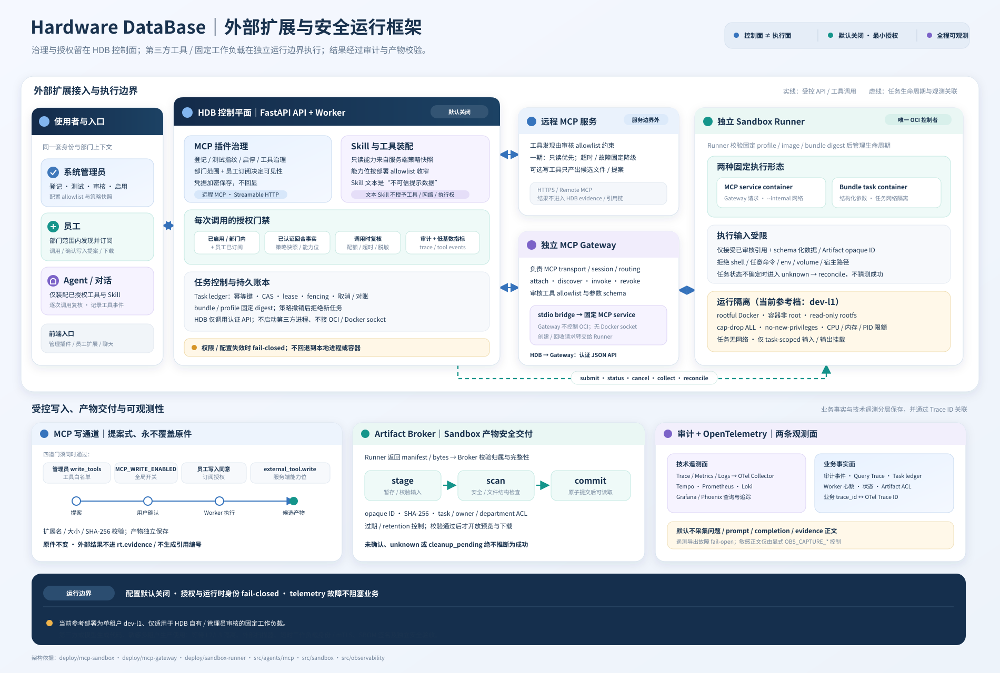

# 22 · 外部扩展：MCP、Skill 与受控运行时

对应代码：`src/agents/mcp/`、`src/sandbox/`、`src/api/routes/plugins.py`、
`src/api/routes/sandbox.py`、`src/observability/metrics.py`；独立服务位于
`deploy/mcp-gateway/` 与 `deploy/sandbox-runner/`。

> 新环境默认关闭 MCP、Skill 与 Sandbox 执行。仓库包含已做真实运行时验证的 dev-l1
> 参考部署，但这不等于生产多租户或不可信代码的安全验收。配置和风险边界以
> [`deploy/mcp-sandbox/README.md`](../deploy/mcp-sandbox/README.md) 为准。

操作步骤见[外部扩展操作指南](../docs/mcp-plugins.md)。



---

## 1. 概念与扩展类型

“扩展”是几个共享身份、部门、订阅和审计能力的功能入口，不是同一种执行方式：

| 类型 | 连接/载体 | HDB 如何使用 | 是否执行代码 |
|---|---|---|---|
| 远程 MCP 插件 | 管理员部署的 Streamable HTTP / SSE MCP server | Agent 在已授权回合内调用远程工具 | HDB 不执行插件代码；远端服务由插件方负责运行 |
| 文本 Skill | 单段文本或受限 Markdown ZIP | 经审核并订阅后，作为带边界声明的不可信 prompt 数据供 Agent 参考 | 否；不改变工具、能力或网络权限 |
| 固定 bundle Skill | Skill 声明绑定到已审核的固定 bundle/profile | 员工提交符合 schema 的结构化参数，由独立 Runner 调度 | 是；执行的是固定 bundle，不是 Skill Markdown |
| 上传执行型 Skill | 固定格式 ZIP，由独立 Runner 的固定模板构建 | 镜像、bundle 与 Skill 分别审核启用后，通过 API 或 Agent 发起任务 | 是；执行镜像由独立 Runner 管理 |
| Sandbox MCP 服务 | Gateway 管理的固定 MCP service profile | HDB 校验工具白名单和订阅后，经 Gateway 调用 | 服务容器由 Runner 创建和回收 |

远程 MCP 与 Sandbox MCP 要区分：前者由 HDB 的 MCP 客户端直接连远程 HTTP 服务；后者的
MCP transport/session 由独立 Gateway 承载，服务进程容器由独立 Runner 管理。HDB API、Worker
和 Agent Runner 都不启动第三方进程，也不接触 OCI/Docker socket。

## 2. 组件职责与信任边界

| 组件 | 职责 | OCI/Docker 控制权 |
|---|---|---:|
| 管理/员工前端 | MCP 登记与审核、Skill 提交与审核、订阅、提案确认、任务查看和产物下载 | 无 |
| HDB API / Worker | 身份与部门校验、策略快照、能力授权、审计、MCP 写提案、任务账本和调度 | 无 |
| HDB Agent Runner | 只装配当前回合已授权的 MCP/Skill 工具；传递结构化参数 | 无 |
| 远程 MCP server | 对外提供远程 MCP 工具 | 插件服务自身负责 |
| 独立 MCP Gateway | MCP transport、session、路由、工具 allowlist/schema 校验；请求 Runner 创建/回收服务 | 无 |
| 独立 Sandbox Runner | 校验固定 digest/profile，管理 service/task 容器、取消、超时、清理与对账 | **唯一拥有** |
| Artifact Broker | opaque ID、扫描、哈希、ACL、原子提交和保留策略 | 无 |

HDB 发给 Sandbox 服务的是 bundle/deployment 引用、结构化 schema 数据和已校验的产物引用；不传
shell、任意命令、宿主路径、容器参数或任意环境快照。认证请求绑定 actor、department、audience、
策略/能力快照与 request ID。

## 3. 授权模型

### 3.1 远程 MCP 工具

服务和工具能否进入一次 Agent 回合由服务端策略决定，而不是由远端 `tools/list` 决定：

1. MCP 总开关启用，服务通过当前配置指纹的连接测试并由管理员启用；
2. 服务部门范围覆盖调用者，且员工已订阅；
3. 工具未被管理员停用；
4. `external_tool.invoke` 由该认证回合的能力快照授予，执行器在调用时再次校验；
5. 还要经过回合调用配额、MCP governor、超时与结果大小限制。

因此，停用服务、移出部门或退订都会让工具不可见；缓存也不能代替调用时授权。

写工具还必须同时满足四道门：管理员 `write_tools` 白名单、`MCP_WRITE_ENABLED=true`、员工
`allow_write` 同意，以及 `external_tool.write` 能力。写工具不会直接在模型回合修改系统或原件：
它先建立提案，用户确认后由 Worker 调用外部服务生成候选产物。

### 3.2 Skill

- Skill 必须处于 `enabled` 状态，且调用者处于允许的部门/所有者范围；员工还必须主动订阅。
- 管理员发布的目录项可限定一个部门或 `*`（全部部门）；员工个人 Skill 绑定上传者的部门，只有上传者和管理员可见，启用后上传者可选择向同部门共享。
- 部门共享不会替员工自动订阅；退订或撤销会阻止新的提示注入/任务提交。
- 文本 Skill 不要求沙箱执行能力，但仍受 `SKILLS_ENABLED`、审核、部门范围和订阅约束。
- 执行型 Skill 除订阅外，还要通过 bundle/profile、运行时策略和当前部署能力检查；所需能力必须同时在部署 allowlist 与用户授权快照内。
- Skill 文本中的 `command`、hooks、权限声明或 prompt injection 文字都是不可信数据，不会成为执行参数或能力授予。

## 4. 管理与员工生命周期

### 4.1 远程 MCP 服务

```text
管理员登记 → 测试连接（绑定配置指纹）→ 启用 → 工具治理/写白名单
员工按部门发现 → 订阅 → Agent 回合授权调用
```

服务连接字段变更后，原测试指纹失效并要求重新测试。凭据加密存储，`MCP_CREDENTIALS_KEY`
只从环境变量读取，不经系统配置 API 返回。

```text
写工具调用 → 写入提案 → 员工确认/拒绝 → Worker 执行 → 候选产物校验与下载
```

校验包含扩展名、大小和 SHA-256；候选文件独立保存，不覆盖原件、不写入 `rt.evidence`，也不获得
知识库引用编号。写提案可能过期或失败，不能将“确认提案”误解为文件已成功生成。

### 4.2 管理员发布 Skill

管理员在「管理后台 → 扩展插件 → Skill 上传与审核」中登记文本 Skill、导入文本 ZIP、绑定固定
bundle，或上传执行型 Skill ZIP。

#### 文本 Skill

- 可直接登记文本，也可导入 ZIP。
- 文本 ZIP 最大 8 MiB，须且仅须有一个 `SKILL.md`；frontmatter 需要 `name` 和 `description`，
  可选 `metadata.version`。允许 Markdown 参考文件和 `LICENSE.txt` / `NOTICE.txt`；文件会按路径
  合并并限制在 16 KiB。代码、图片和其他资产不接受。
- 审核内容与适用部门后，管理员手动推进 `draft → reviewed → tested → enabled`。测试状态由管理员
  在实际验证后标记；启用后员工才可订阅。

#### 固定 bundle Skill

管理员可把一个文本 Skill 绑定到已登记并启用的 curated bundle。Skill 与 bundle 各自有审核状态；
开始执行前，bundle digest、profile、schema、能力和当前部署策略都要重新核验。重新登记或变更文本、
部门范围、版本、bundle 绑定时，需要按状态机重新审核。

#### 上传执行型 Skill

- ZIP 格式包括 `SKILL.md`、`entrypoint.py`，可含受支持的文本/Python 帮助文件；上传上限 8 MiB。
  入口读取 `/work/in/parameters.json` 并在 `/work/out` 写候选产物。
- 管理员上传的包由 HDB 请求独立 Runner 使用固定模板构建；构建失败时保留草稿和源包，可重试。
- 员工个人上传的执行包**不会由员工请求触发构建**：管理员先下载和审核源码，再批准源包；之后才允许 Runner 构建。
- 仅允许管理员配置的 HTTPS pip 主机。可选 `requirements.lock` 必须将每个依赖固定到版本并列出
  SHA-256 wheel 哈希；Runner 构建阶段再次验证。任务容器始终不联网、不动态安装依赖。
- 管理员分别审核/测试/启用生成的 bundle 与 Skill。执行前两者必须都启用，且 digest/profile 匹配。

员工个人提交的文本或执行型 Skill 都先是私有草稿。管理员审核启用后，提交者可将 Skill 添加到个人
对话；也可选择共享给所属部门。部门内其他员工仍须自行订阅。撤销或停止共享会阻止之后的新使用。

### 4.3 员工使用 Skill

员工在「侧边栏 → 扩展 → Skill 库」中搜索已启用且符合部门/所有者范围的 Skill：

- 点击「添加 Skill」后，文本 Skill 会在该员工的对话上下文中以不可信参考块出现。
- 执行型 Skill 添加后可在页面打开「测试 Skill」，按 schema 输入 JSON 并提交；也可由 Agent 在受控
  工具回合中调用。页面显示任务状态，成功且 commit 的产物才可下载。
- 执行权限按调用身份和部门重新计算；订阅不能代替能力授权。缺少 Runner、运行档位不匹配或授权撤销
  时，请求会被拒绝，而不是退回本地执行。

## 5. Sandbox 任务、账本与产物

执行型 Skill 和 Sandbox MCP service 都使用独立 Runner。任务主要阶段如下：

```text
admit → submit → observe → (cancel) → collect → reconcile
```

HDB 账本绑定幂等键、请求指纹、bundle/Skill digest、策略快照、能力快照、owner 和 department，使用
CAS、lease 与 fencing 处理并发与恢复。Runner 重启后无法确认执行身份的任务进入 `unknown` / 对账流程；
`cleanup_pending`、`reconcile_required` 等状态不视为成功。停用、吊销策略会阻止新任务；运行中任务依
取消和清理确认终结。

Runner 回传产物先到 Artifact Broker：

```text
stage → scan → commit → 产生可读取的 opaque artifact ID
```

Broker 校验 manifest、哈希、路径/归档安全、task/owner/department ACL、扫描结果和原子提交。仅 commit
后的产物可预览或下载；任务只在结果校验通过后标为 `succeeded`。内置 `scanner://builtin/basic-v1`
是结构检查，不等同杀毒或生产级内容扫描器。

## 6. 开关与部署状态

| 功能 | 关键开关 | 默认值 | 说明 |
|---|---|---|---|
| 远程 MCP | `MCP_ENABLED` | `false` | 还要求统一工具路径、资源 governor 等前置条件 |
| MCP 写工具 | `MCP_WRITE_ENABLED` | `false` | 另需工具白名单、员工同意和 `external_tool.write` |
| Skill catalog | `SKILLS_ENABLED` | `false` | 控制文本 Skill 与 Skill 发现/提示注入 |
| Sandbox task | `SANDBOX_ENABLED` | `false` | 执行型 Skill；必须配置 `SANDBOX_BACKEND=runner_api` 和独立 Runner |
| Sandbox MCP Gateway | `SANDBOX_GATEWAY_ENABLED` | `false` | 必须配置独立 Gateway/Runner、身份和策略 attestation |

启用 Sandbox 前还需设置 Runner/Gateway URL、服务身份和认证凭据、运行时 attestation/profile digest 与
Artifact Scanner 引用。HDB 只接受运维控制的这些配置；策略校验失败时 fail-closed。

当前参考 Runner 档位 `dev-l1` 基于 rootful Docker，但容器使用非 root、只读 rootfs、能力裁剪、资源限额、
任务无网络和 task-scoped 挂载。适用范围是单租户、受信任且经管理员审核的固定负载。第三方或模型生成
代码、敏感多租户生产执行仍需 L2/L3 隔离（如 rootless OCI、gVisor、Kata/microVM）、外部扫描器、
短期工作负载身份/mTLS、SBOM/签名和独立安全验收；dev-l1 不能作为这些场景的安全证明。

## 7. 审计与可观测性

- MCP 记录 `tool_started` / `tool_result` 与调用时延、结果大小、截断和降级事件；关键审计覆盖登记、测试、
  启停、工具治理、订阅、写入同意、提案确认、产物接收和调用。
- 低基数 MCP 指标包括 `hdb.mcp.call_count`、`hdb.mcp.call_duration_seconds`、
  `hdb.mcp.discovery_count`、`hdb.mcp.tools.discovered`、写入及产物拒绝计数；不把用户 ID、部门 ID、
  server slug 或 tool name 当作指标标签。
- Sandbox 指标包括 `hdb.sandbox.task_count`、`hdb.sandbox.task_duration_seconds`、
  `hdb.sandbox.state_count` 与 `hdb.sandbox.artifact_count`。
- OTel Trace / Metrics / Logs 经 Collector 路由到 Tempo、Prometheus、Loki；Grafana 和 Phoenix 用于查看。
  业务审计、任务状态与 Query Trace 单独持久化，并通过 `otel_trace_id` 关联技术 trace。
- 默认不导出问题、prompt、completion 或 evidence 正文。遥测导出失败 fail-open；权限、策略和产物完整性
  验证 fail-closed。

## 8. 代码与部署索引

| 内容 | 位置 |
|---|---|
| MCP 插件存储、策略、客户端与执行器 | `src/agents/mcp/` |
| Skill catalog、包校验和个人提交 | `src/sandbox/skills.py`、`src/sandbox/skill_packages.py` |
| Agent Skill 工具 | `src/sandbox/agent_tools.py`、`src/agents/runner.py` |
| Sandbox API 与权限检查 | `src/api/routes/sandbox.py`、`src/sandbox/authorization.py`、`src/sandbox/policy.py` |
| 任务账本、生命周期和产物 | `src/sandbox/task_store.py`、`src/sandbox/service.py`、`src/sandbox/artifact_broker.py` |
| 外部 MCP API | `src/api/routes/plugins.py` |
| 独立 Gateway / Runner | `deploy/mcp-gateway/`、`deploy/sandbox-runner/` |
| 前端操作 | `frontend/src/pages/admin/PluginsPage.tsx`、`frontend/src/pages/admin/SkillsPanel.tsx`、`frontend/src/pages/ExtensionsPage.tsx` |
| 面向管理员/员工的操作步骤 | [`docs/mcp-plugins.md`](../docs/mcp-plugins.md) |

扩展整个仓库时还应遵守 [21 · 已知陷阱与扩展指南](21-gotchas-and-extension-guide.md) 中的权限、审计、
幂等、fail-closed 和测试要求。
